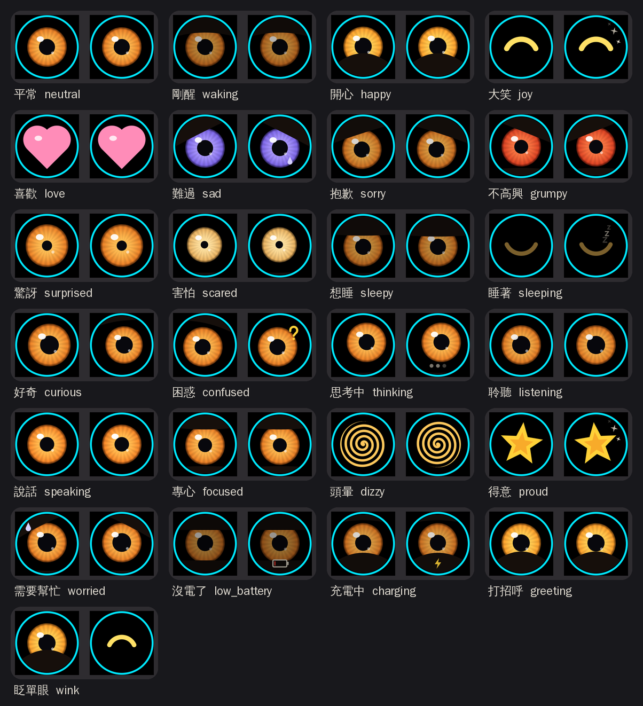
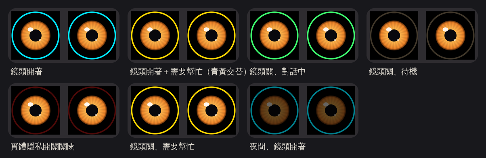

# 鴨子的眼睛：表情、使用情境與音效（設計 v1）

- 狀態：**設計 v1**。渲染程式 [`robot/eyes/`](../robot/eyes/README.md) 可以產生每一幀畫面，單元測試與預覽圖通過；**還沒上螢幕、沒實機**（螢幕未到貨，SPI 驅動要等 E1）。**音效只有規格，聲音檔還沒做。**
- 日期：2026-11-18
- 硬體：GC9A01 1.28 吋圓形螢幕 ×2（[眼睛硬體設計](../hardware/expression_mods/gc9a01_eyes.md)）
- 相關：[ADR-0006 §4.2](adr/ADR-0006-privacy-settings.md#42-鏡頭狀態提示眼燈顏色2026-11-12-決定)（狀態環顏色）、[ADR-0013](adr/ADR-0013-camera-always-on-and-home-monitoring.md)（鏡頭常開）、[雙目視覺規劃](stereo_vision_plan.md)（看著對方說話）
- 驗證紀錄：[`validation/eyes-render-2026-11-18.md`](validation/eyes-render-2026-11-18.md)



動畫輪播（每個表情 1.5 秒，含過場與眨眼）：[`eyes-showreel-2026-11-18.gif`](validation/media/eyes-showreel-2026-11-18.gif)

## 1. 設計原則

1. **溫和的卡通鴨眼**：琥珀色虹膜（呼應鴨嘴的橘黃）、大瞳孔、兩點角膜高光；黑底，眼皮是很深的暖褐色，讓眼皮形狀在黑底上也看得出來。
2. **兩層畫面**：最外圈的**狀態環**只看實際裝置狀態（鏡頭、實體隱私開關、需要幫忙），**表情蓋不到**；表情畫在內圈。程式裡兩層的像素範圍不重疊，測試逐一檢查每個表情都改不到狀態環。
3. **青色保留給「鏡頭開著」**：表情層不能用青色系（色相 160°～205°）；眼淚、汗滴用淡紫白，不用水藍。測試檢查每個表情、每個動畫時間點的像素。
4. **不假裝**：
   - 「看著你」只在有**真實的人臉偵測或聲源方向**時才看過去；沒有目標就只是小幅自然飄動，不假裝在看人。
   - 「說話」時虹膜亮度只跟著**真的播放音量**；沒有音量資料就不動，不假裝對嘴。
   - 「沒電了」的電池圖示用**真實電量**。
   - 「聆聽」只在麥克風**真的在把聲音送給 Nous**時顯示（ADR-0003）。
   - **鏡頭開著時不顯示閉眼睡著**：閉眼會讓人以為鴨子沒在看（ADR-0007 §2.2）。
5. **表情是溝通，不是情緒**：鴨子沒有情緒。表情是讓人一眼看懂「鴨子現在在做什麼、需要什麼」的介面，文件與 Nous 的說法都不宣稱鴨子「感到」什麼。
6. **不嚇人**：不做兇狠、恐怖的表情。「不高興」是嘟嘴，不是生氣；沒有血紅眼、沒有「X 死掉眼」。小孩看了也不會怕。
7. **夜間**：表情層亮度 ×0.4；狀態環也調暗，但「鏡頭開著」的青色有最低亮度，一定看得見；夜間不播音效（ADR-0006 夜間模式「不出聲」）。

## 2. 畫面規格

| 項目 | 值 | 說明 |
|---|---|---|
| 解析度 | 240×240、RGB565 | GC9A01 |
| 狀態環 | 半徑 112～119 px | 寬 7 px；新頭殼眼孔 ≥ Ø32.4 mm 時整圈看得到 |
| 表情層 | 半徑 109 px 以內 | 和狀態環中間留 3 px 黑邊 |
| 虹膜 | 半徑 74 px（依表情 66～80） | 往左右最多移 24 px、上下 20 px |
| 眼皮 | 上下各一片，可閉合、傾斜、彎曲 | 傾斜為正＝內側較低（不高興）；為負＝內側較高（難過、擔心） |
| 過場 | 0.22 秒 | 同形狀就平滑變形；形狀不同（例如圓眼變愛心）就先暗下再亮起 |
| 自動眨眼 | 0.16 秒，間隔依表情 1.2～8 秒隨機 | 睡著、大笑、頭暈等閉眼或特殊形狀不眨 |
| 兩眼順序 | 畫面左、畫面右 | 站在鴨子面前看到的左右；畫面左＝鴨子的右眼 |

**注意**：上面的狀態環位置是給**新頭殼**（眼孔 ≥ Ø32.4 mm）用的。若沿用原版 Ø25 mm 眼孔，只看得到半徑 92 px 以內，狀態環會被擋住，要把狀態環往內移（[眼睛硬體設計 §2](../hardware/expression_mods/gc9a01_eyes.md#2-與原版眼睛零件的關係stl-量測)）。

## 3. 表情一覽

「誰能觸發」：**本機**＝只能由鴨子依真實狀態觸發；**Nous**＝Nous 也可以要求（之後的 `app.duck.express`）。程式裡的清單在 [`policy.py`](../robot/eyes/duck_eyes/policy.py)。

| 代號 | 名稱 | 外觀 | 什麼時候用 | 音效 | 誰能觸發 |
|---|---|---|---|---|---|
| `neutral` | 平常 | 琥珀色圓眼、上眼皮微蓋、眼睛偶爾小幅飄動 | 閒置、等待、沒有特別的事 | 無 | Nous、本機 |
| `waking` | 剛醒 | 從閉眼慢慢張開，亮度由暗變亮 | 開機、從休息醒來 | `boot_chirp` | 本機 |
| `happy` | 開心 | 暖黃虹膜，下眼皮往上推成笑眼，輕輕彈跳 | 被稱讚、事情順利、跟人互動愉快 | `quack_happy` | Nous |
| `joy` | 大笑 | 兩眼變成 ^ ^，旁邊有小星光 | 很開心、玩遊戲贏了、被逗笑 | `giggle_trill` | Nous |
| `love` | 喜歡 | 粉紅愛心眼，像心跳一樣跳動 | 有人說喜歡鴨子、被摸頭（之後若有觸覺感測） | `coo_love` | Nous |
| `sad` | 難過 | 淡紫虹膜、八字眼皮、往下看，一顆眼淚滑下 | 聽到難過的事時陪伴、被說「再見」 | `sad_slide` | Nous |
| `sorry` | 抱歉 | 低頭、眼皮下垂、略暗 | 任務沒完成、聽錯、做錯事 | `sorry_hum` | Nous |
| `grumpy` | 不高興 | 橘紅虹膜、V 字眼皮、瞳孔變小（嘟嘴，不兇） | 開玩笑式的抗議（例如被要求做不到的事） | `grumble` | Nous |
| `surprised` | 驚訝 | 眼皮全開、虹膜放大、瞳孔變小 | 聽到喚醒詞的瞬間、被抱起、突然有人出現 | `surprise_up` | Nous、本機 |
| `scared` | 害怕 | 淡色虹膜、極小瞳孔、眼睛輕微顫抖 | 偵測到前方落差急停、很大的聲響 | `scared_wobble` | 本機 |
| `sleepy` | 想睡 | 眼皮半垂、慢慢眨眼、略暗 | 夜間待在充電座（鏡頭開著時的休息樣子）、很晚了 | `yawn` | Nous、本機 |
| `sleeping` | 睡著 | 閉眼 ‿、很暗，Zzz 往上飄 | **只在鏡頭關著時**的夜間休息 | 無 | 本機 |
| `curious` | 好奇 | 一眼大一眼小、瞳孔放大、左右張望 | 迷路轉頭找標籤、看到新東西、被問到新問題 | `curious_chirp` | Nous、本機 |
| `confused` | 困惑 | 兩眼眼皮一高一低、往下看，問號浮動 | 沒聽懂、指令不清楚、找不到 Nous | `confused_hm` | Nous、本機 |
| `thinking` | 思考中 | 眼睛往右上看、下方三個點輪流亮 | 等 Nous 回答 | 無（不製造噪音） | Nous、本機 |
| `listening` | 聆聽 | 眼睛張大、瞳孔放大、輕微呼吸般明暗 | 麥克風正在把聲音送給 Nous | `listen_on` | 本機 |
| `speaking` | 說話 | 平常眼，虹膜亮度與瞳孔跟著**真實播放音量** | Nous 透過鴨子的喇叭說話 | 無（Nous 的語音本身） | 本機 |
| `focused` | 專心 | 上下眼皮都收、瞳孔變小、看前下方 | 走路導航、對準充電座 | 無 | 本機 |
| `dizzy` | 頭暈 | 兩眼變成反向旋轉的螺旋 | 跌倒後、被搖晃 | `dizzy_wobble` | 本機 |
| `proud` | 得意 | 金色星星眼，左右擺動，旁邊有星光 | 任務完成（找到人、走到目的地、回充成功） | `proud_fanfare` | Nous |
| `worried` | 需要幫忙 | 八字眼皮、往上看、瞳孔放大，汗滴滑下 | 跌倒爬不起來、卡住、迷路求助、過熱停機 | `help_call` | 本機 |
| `low_battery` | 沒電了 | 半閉眼、很暗，下方紅色電池圖示閃動（顯示真實電量） | 電量低、正要回充電座 | `battery_low` | 本機 |
| `charging` | 充電中 | 放鬆的笑眼，下方閃電圖示慢慢亮暗 | 剛接上充電座、充電中 | `charge_start` | 本機 |
| `greeting` | 打招呼 | 開心的笑眼（和開心一樣，搭配打招呼鴨叫） | 認出家人、早安、有人回家 | `quack_hello` | Nous |
| `wink` | 眨單眼 | 一眼開心、一眼 ^ 閉上，0.7 秒後回到原本表情 | 開玩笑、「交給我吧」、答應事情 | `wink_click` | Nous |

狀態環的各種狀態（青色、青黃交替、綠色呼吸、暖白、暗紅、黃色閃）見下圖與 ADR-0006 §4.2 的表：



## 4. 使用情境

觸發來源都是**真實事件**；表情欄的「→」表示依序切換。狀態環以鏡頭常開（ADR-0007）為前提，所以大多是青色。

| # | 情境 | 觸發來源（真實事件） | 表情 | 狀態環 | 音效 | 備註 |
|---|---|---|---|---|---|---|
| 1 | 開機 | 渲染程式啟動 | `waking` → `neutral` | 鏡頭開始串流後變青色；之前依實際狀態 | `boot_chirp` | 渲染程式第一幀之前背光不亮 |
| 2 | 閒置 | 沒有任務、沒有對話 | `neutral` | 青色 | 無 | 自動眨眼、眼睛小幅飄動 |
| 3 | 聽到喚醒詞 | 感知板喚醒詞偵測（ADR-0003） | `surprised`（0.3 秒）→ `listening` | 青色 | 只播 `listen_on`（這裡不播 `surprise_up`，避免疊音） | 「開始聽」只在聲音真的開始送 Nous 時播 |
| 4 | 聆聽中 | 收音工作階段進行中 | `listening`，眼睛看向**聲源方向** | 青色 | 無 | 方向來自麥克風陣列 DOA；沒有方向就看正前方 |
| 5 | 等 Nous 回答 | 收音結束、還沒收到回應 | `thinking` | 青色 | `listen_off` | 超過 8 秒沒回應 → 情境 21 |
| 6 | Nous 說話 | 鴨子喇叭在播 Nous 的語音 | `speaking`（亮度跟著真實音量） | 青色 | 無 | 說話時不播任何表情音效 |
| 7 | 看著說話的人 | 人臉偵測到正在說話的人（雙目視覺 V3） | 目前表情＋眼睛看向那張臉 | 青色 | 無 | 沒偵測到臉就不假裝在看 |
| 8 | 認出家人 | Nous 回傳辨識結果 matched（雙目視覺 P8） | `greeting` | 青色 | `quack_hello` | 辨識結果不等於授權（AIOS ADR-0001） |
| 9 | 被稱讚、互動愉快 | Nous 判斷後要求 | `happy` 或 `joy` | 青色 | `quack_happy`／`giggle_trill` | |
| 10 | 有人說喜歡鴨子 | Nous 判斷後要求 | `love`（3 秒）→ `happy` | 青色 | `coo_love` | |
| 11 | 沒聽懂 | Nous 回報不確定、或語音辨識失敗 | `confused` | 青色 | `confused_hm` | 同時由 Nous 用語音請對方再說一次 |
| 12 | 任務完成 | 到達目的地、找到人、回充成功（鴨子本機確認） | `proud`（2 秒）→ `happy` | 青色 | `proud_fanfare` | 只有本機確認完成才算；送出但沒確認不播 |
| 13 | 任務沒完成 | 找不到人、門關著、被禁止進入的房間 | `sorry` | 青色 | `sorry_hum` | Nous 同時用語音說明原因（ADR-0006 `refused`） |
| 14 | 走路導航 | 導航任務進行中 | `focused` | 青色 | 無 | 走路時不播音效，避免干擾收音 |
| 15 | 迷路找標籤 | 定位失去信心、轉頭掃描（雙目視覺 N6） | `curious`，眼睛跟著頭轉的方向看 | 青色 | `curious_chirp`（一次） | 找不到 → 情境 19 |
| 16 | 前方有落差、急停 | ToF 或視覺偵測到樓梯口（ADR-0002） | `scared`（1 秒）→ `focused` | 青色 | `scared_wobble` | 安全動作先做，表情只是告知 |
| 17 | 被抱起 | IMU 偵測離地、足底開關全放開 | `surprised` → `curious` | 青色 | `surprise_up` | 步態已由安全模組停下 |
| 18 | 跌倒 | IMU 跌倒判定（`robot/safety/`） | `dizzy`（2 秒）→ `worried` | 青黃交替 | `dizzy_wobble` → `help_call` | 鴨子同時回報事件給 Nous |
| 19 | 需要幫忙（卡住、迷路、過熱） | 安全或導航模組回報 | `worried` | 青黃交替 | `help_call`（最多 3 次、每 20 秒） | 夜間不播聲音，改由 Nous 通知 |
| 20 | 低電量 | 電量低於回充門檻 | `low_battery` → 走路回家時 `focused` | 青色 | `battery_low`（每 5 分鐘最多一次） | 電池圖示用真實電量 |
| 21 | Nous 沒有回應、斷線 | duck-link 心跳逾時 | `confused` | 青色 | `confused_hm`（一次） | 鴨子本機的安全與步態照常；不假裝還連著 |
| 22 | 回到充電座 | 充電觸點確認有充電電流（ADR-0004） | `charging` | 青色 | `charge_start` | 只有電氣確認在充電才顯示 |
| 23 | 白天待在充電座 | 充電中或充飽、沒有任務 | `charging` → 充飽後 `neutral` | 青色 | 無 | 鏡頭常開，這時也是家庭監控的位置（ADR-0007） |
| 24 | 夜間待在充電座 | 夜間模式時段 | 鏡頭開著：`sleepy`；鏡頭關著：`sleeping` | 青色（夜間調暗但看得見） | 無 | **鏡頭開著時不閉眼**（§1 第 4 點） |
| 25 | 叫人起床 | 排程任務（R-001 S1，ADR-0006 例外） | `greeting` → `happy` | 青色 | `quack_hello`，音量用「大」 | 叫人的話由 Nous 語音說；只有這個情境用大音量 |
| 26 | 隱私模式、實體開關關閉 | 實體開關 GPIO、設定切換 | 不變（照當下情境） | 暗紅（開關）或依實際狀態 | 無 | 鏡頭真的沒電時狀態環才不是青色 |
| 27 | 開玩笑、答應事情 | Nous 要求 | `wink` | 青色 | `wink_click` | |
| 28 | 被要求做不到的事 | Nous 判斷後要求 | `grumpy`（1.5 秒）→ `sorry` | 青色 | `grumble` | 不兇；之後由 Nous 說明做不到的原因 |
| 29 | 有人遠端在看畫面 | （**ADR-0007 提議，未採用**） | 不變 | 待定（提議：加上明顯的「有人在看」提示） | 待定（提議：開始觀看時一聲提示音） | 要等 ADR-0007 決定 |

## 5. 音效

### 5.1 原則

1. **非語言**：短促的合成鴨叫、啾聲、滑音。說話一律由 Nous 的語音負責，表情音效不模仿人聲說話。
2. **原創合成**：用簡單的振盪器、滑音、共振峰濾波產生，不取樣真實鴨子或其他產品的聲音。
3. **不和 Nous 的語音疊在一起**：Nous 說話時不播；麥克風正在收音時也不播（避免干擾 Nous 聽和回音消除），`listen_on` 例外（在開始送聲音之前播完）。
4. **夜間不出聲**（ADR-0006 夜間模式）；房間設定「不可出聲」時也不播。需要幫忙改由 Nous 通知手機或其他終端。
5. **不像警報**：不模仿煙霧警報、門鈴、手機鈴聲，避免家人誤會。
6. **同一個音效有冷卻時間**：同一音效 3 秒內不重播（`help_call`、`battery_low` 另有更長的間隔）。
7. **不用聲音假裝能力**：沒在聽就不播「開始聽」，任務沒有確認完成就不播「完成」。

### 5.2 音量等級（要在實機喇叭上校正）

| 等級 | 目標（RMS） | 用在 |
|---|---|---|
| 小 | −26 dBFS | 大部分回饋音 |
| 中 | −18 dBFS | 打招呼、開心、求救、低電量 |
| 大 | −12 dBFS | 只有叫人起床（情境 25） |

數字是起點，喇叭還沒裝（ADR-0005：上游的小喇叭音量可能不夠，要實測）。

### 5.3 音效規格

「合成鴨叫」＝鋸齒波基頻經過兩個帶通共振峰（約 1.0 kHz 與 2.4 kHz），加一點低頻嗡聲，聽起來像短促的「呱」。頻率與時長是設計起點，做出聲音後依實際聽感調整。

| 代號 | 名稱 | 聽起來像 | 合成方式 | 長度 | 音量 |
|---|---|---|---|---|---|
| `boot_chirp` | 開機啾啾 | 兩聲往上的小鳥啾 | 正弦 1.2→2.0 kHz 70 ms，停 40 ms，再 1.5→2.6 kHz 70 ms | 0.25 s | 小 |
| `quack_hello` | 打招呼鴨叫 | 「呱～」尾音上揚 | 合成鴨叫，基頻 420→360→440 Hz | 0.25 s | 中（叫起床用大） |
| `quack_happy` | 開心兩聲鴨叫 | 「呱呱！」第二聲較高 | 合成鴨叫 90 ms ×2，間隔 70 ms，第二聲高 3 個半音 | 0.3 s | 中 |
| `giggle_trill` | 咯咯笑顫音 | 一串快速的小鴨叫 | 5 個 40 ms 合成鴨叫，間隔 55 ms，基頻 520 Hz ±20、漸弱 | 0.35 s | 中 |
| `coo_love` | 撒嬌咕嚕 | 低柔、帶顫音的「嗚～」 | 正弦 330→392 Hz 滑音，5 Hz 顫音 | 0.4 s | 小 |
| `sad_slide` | 下滑嗚 | 往下滑的「嗚…」 | 正弦 520→300 Hz 指數下滑，4 Hz 輕顫 | 0.6 s | 小 |
| `sorry_hum` | 低聲嗯… | 兩個低音「嗯…」 | 三角波 294 Hz 120 ms → 262 Hz 220 ms | 0.35 s | 小 |
| `grumble` | 嘟囔 | 低低的咕噥，不兇 | 鋸齒波 140～170 Hz、8 Hz 不規則調變，900 Hz 低通 | 0.35 s | 小 |
| `surprise_up` | 上揚「喔！」 | 快速往上的「咻—呱」 | 正弦 400→1100 Hz 150 ms，接一聲 60 ms 短鴨叫 | 0.25 s | 中 |
| `scared_wobble` | 顫抖嗚 | 發抖的高音 | 正弦 700 Hz、±60 Hz 以 12 Hz 顫動 | 0.3 s | 小 |
| `yawn` | 打哈欠 | 慢慢往下的「啊～」 | 鋸齒波經 1.2 kHz 低通，基頻 380→220 Hz，漸強再漸弱 | 0.8 s | 小 |
| `curious_chirp` | 好奇「啾？」 | 往上揚的啾 | 正弦 900→1500 Hz | 0.12 s | 小 |
| `confused_hm` | 疑問「嗯？」 | 尾音上揚的「嗯？」 | 三角波 330 Hz 150 ms → 440 Hz 150 ms | 0.3 s | 小 |
| `listen_on` | 開始聽 | 「嘟嘟」往上 | 正弦 880 Hz 50 ms → 1320 Hz 50 ms | 0.12 s | 小 |
| `listen_off` | 聽完了 | 「嘟嘟」往下 | 正弦 1320 Hz 50 ms → 880 Hz 50 ms | 0.12 s | 小 |
| `dizzy_wobble` | 暈眩搖擺音 | 轉圈圈的「嗚哇嗚哇」 | 正弦 600 Hz ±150 Hz 以 3 Hz 擺動，音量也以 3 Hz 起伏 | 0.8 s | 小 |
| `proud_fanfare` | 小號角 | 三音往上的「噹噹噹—呱」 | 柔化方波 1047、1319、1568 Hz 各 80 ms，接一聲短鴨叫 | 0.4 s | 中 |
| `help_call` | 求救三聲 | 三聲中等鴨叫「呱、呱、呱」 | 合成鴨叫 500 Hz 150 ms，間隔 250 ms；每 20 秒最多重播一次、最多 3 次 | 0.95 s | 中 |
| `battery_low` | 沒電下降兩音 | 「嘟—嘟」往下 | 柔化方波 660 Hz 150 ms → 440 Hz 150 ms；每 5 分鐘最多一次 | 0.3 s | 中 |
| `charge_start` | 充電上升琶音 | 輕快的三音往上 | 正弦 523、659、784 Hz 各 70 ms | 0.25 s | 小 |
| `wink_click` | 眨眼「叮」 | 清脆的一聲「叮」 | 正弦 1760 Hz 40 ms，快速衰減 | 0.05 s | 小 |

聲音檔會由一個小的合成程式產生（規劃中，放 `robot/audio/`），不放錄音檔。渲染程式（`EyeAnimator`）在切換表情時只**回報**該表情的音效代號；要不要真的播，由之後的行為層依 §5.1 的規則決定（例如情境 3 不播 `surprise_up`、夜間全部不播）。

## 6. 規則：衝突時誰優先

同一時間可能有好幾個事件，表情依下面的順序決定（上面的蓋過下面的）：

1. **安全**：跌倒（`dizzy` → `worried`）、急停（`scared`）、需要幫忙（`worried`）。
2. **電量**：`low_battery`（正在回充時改 `focused`）。
3. **對話**：`listening`、`thinking`、`speaking`。
4. **任務**：`focused`、`curious`（找標籤）、`proud`／`sorry`（結果）。
5. **Nous 要求的社交表情**：只能用 [`policy.py`](../robot/eyes/duck_eyes/policy.py) 的 `NOUS_ALLOWED` 清單，而且不能蓋過 1～3。
6. **閒置與休息**：`neutral`、`charging`、`sleepy`、`sleeping`（`sleeping` 只在鏡頭關著時）。

固定規則（程式與測試都有檢查）：

- 狀態環只看裝置狀態，表情與 Nous 都改不到（`status.ring_spec` 沒有表情參數；測試比對每個表情下的狀態環像素）。
- 代表真實狀態的表情（`worried`、`low_battery`、`charging`、`listening`、`speaking`、`dizzy`、`focused`、`scared`、`sleeping`、`waking`）**Nous 叫不出來**，只能由鴨子本機的真實事件觸發。
- 鏡頭在串流時，休息的樣子是 `sleepy` 或 `neutral`，不是閉眼的 `sleeping`（`policy.resting_expression`）。

## 7. 預覽與驗證

```bash
cd nous_duck/robot/eyes
pip install -r requirements-dev.txt
python -m pytest tests -q
python -m duck_eyes.preview --out /tmp/eyes --bench
```

- 單元測試：狀態環優先順序、夜間最低亮度、每個表情都蓋不到狀態環、青色保留、表情不出界、可重現、眨眼、注視只跟真實目標、說話不假裝對嘴、動作型表情會回復、音效只觸發一次、RGB565 轉換、局部更新範圍、文件與程式一致。
- 預覽圖：本文開頭的總覽圖、狀態環圖、動畫輪播都由 `duck_eyes.preview` 產生。
- **沒驗證的**：真實螢幕上的顏色、亮度、可視角；Pi 4 上的渲染速度（雲端容器量的數字見驗證紀錄，Pi 4 一定比較慢）；SPI 傳輸；音效（還沒做）。

## 8. 待決

1. 眼睛外觀：這一版是琥珀色卡通眼。要不要換顏色或風格，看過預覽圖後決定。
2. 音效的實際聲音：做出合成程式、在實機喇叭上聽過再調。
3. Pi 4 上能跑多快：雲端容器一幀（兩眼）約 10～20 ms；Pi 4 要實測。太慢的話先做局部更新與快取靜態圖層。
4. 情境 29（遠端觀看的提示）：等 ADR-0007。
5. `app.duck.express` 的 schema（duck-link 批次 E4）：參數是表情代號＋可選的持續秒數；鴨子回報「目前顯示的表情」，但面板沒有回讀，所以這是渲染程式的狀態，不是面板的證據。
