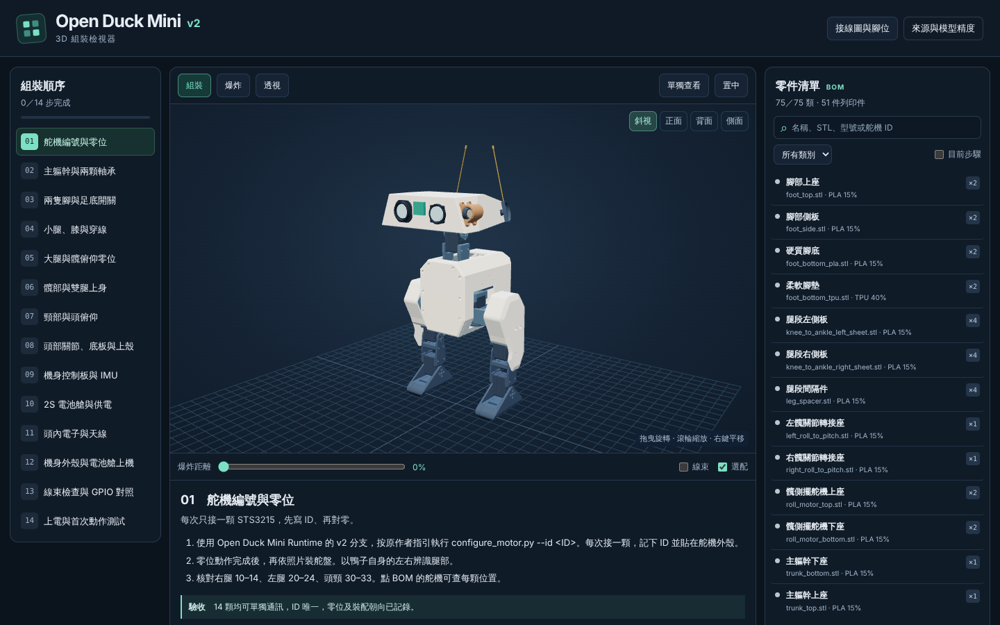

# ChatGPT 版 3D 組裝檢視器成品（備用）

這是 ChatGPT 在 2026-11-12 做出的 `Open_Duck_Mini_v2_Assembly_Viewer.html` 成品。當初以為只存在 ChatGPT 的沙箱、拿不到；使用者在 2026-11-14 上傳了這個檔案，**原封不動**存放在這裡，當作備用。

> ⚠️ **這是 ChatGPT 的產出，不是本 repo 的實作，內容沒有經過本 repo 驗證。** 它的產生程式見 [`../chatgpt_viewer_src/`](../chatgpt_viewer_src/README.md)。本 repo 自己的檢視器在 [`../../../assembly_viewer/`](../../../assembly_viewer/README.md)。

| 項目 | 內容 |
|---|---|
| 檔案 | [`Open_Duck_Mini_v2_Assembly_Viewer.html`](Open_Duck_Mini_v2_Assembly_Viewer.html)，16,674,219 bytes |
| sha256 | `cfa49ca183e375d743956195abc3a984cd7ce8de54b4fa40a453aea1ec43464e` |
| 對應上游 | `apirrone/Open_Duck_Mini` commit `b23317a`（檔案內的 `DATA.commit`） |
| 內嵌內容 | three.js r160（MIT）、52 個網格（int16 量化＋gzip）、零件與 14 個組裝步驟、BOM 75 類、22 張照片與接線圖 |
| 照片來源 | 看起來是上游組裝指南的照片、CAD 圖與接線圖（機構與電路，沒有人或住家）；由 ChatGPT 的 `photos.py` 下載縮圖 |
| 修改 | 無（與上傳檔案位元組相同） |

## 本 repo 對它做過的檢查（2026-11-14）

**只確認「打得開」，沒有檢查內容是否正確。**

- 用 Playwright Chromium（SwiftShader WebGL）以 `file://` 開啟，**擋掉所有網路請求**：沒有任何對外請求、沒有 JavaScript 錯誤，WebGL 畫布正常建立，3D 模型、14 個步驟與 BOM 都有顯示。截圖：[`headless-offline-2026-11-14.png`](headless-offline-2026-11-14.png)。
- 掃過內嵌資料：沒有個人資料或電子郵件；外部連結只有上游 GitHub 與 three.js 文件。
- 頁面會用瀏覽器的 `localStorage` 記住組裝步驟的完成狀態（只存在自己的瀏覽器）。

## 沒有驗證的事

- 14 顆舵機的 ID 對應、零件位置、組裝步驟內容是否正確（ChatGPT 用匈牙利演算法自動配對，見 [`../handoff_summary.md`](../handoff_summary.md#6-第一個軟體交付離線-3d-組裝檢視器)）。
- ChatGPT 自己說明部分電子板、線束、緊固件是示意。
- 不含 Nous Duck 的改裝（感知板、鏡頭、麥克風、充電座觸點板等）。

