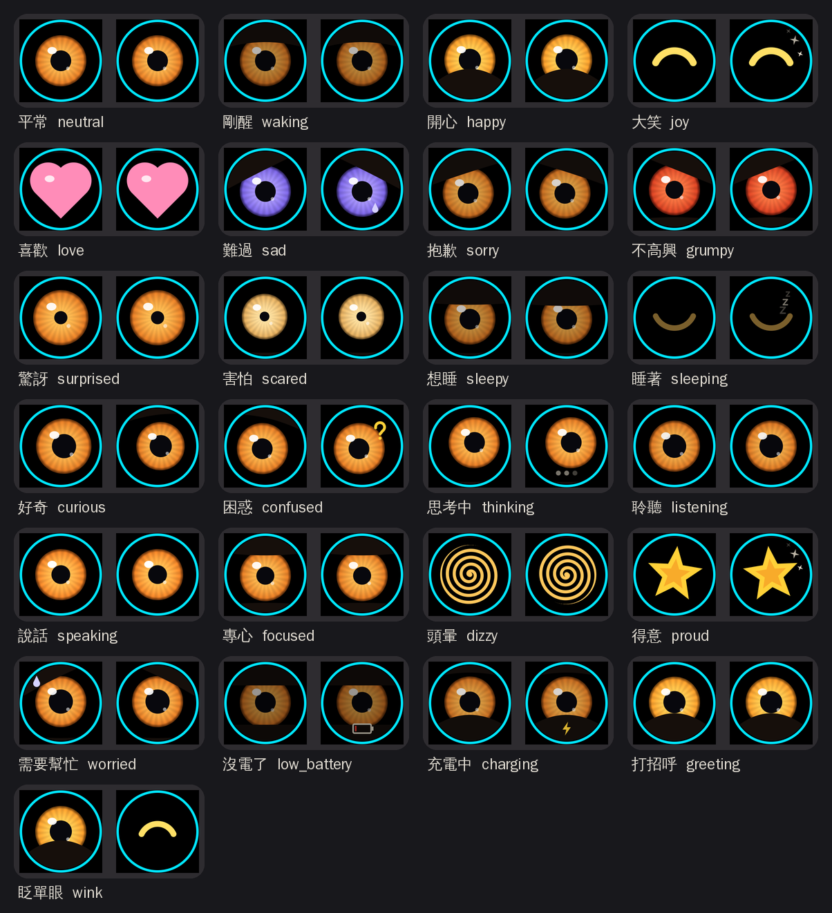
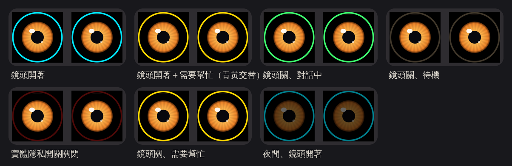

# 眼睛渲染程式：表情、狀態環、預覽圖（2026-11-18）

- 分支：`claude/lucid-gates-0hbxak`
- 對象：[`robot/eyes/`](../../robot/eyes/README.md) 與 [眼睛設計 v1](../eye_expressions.md)
- **驗證層級：單元測試＋預覽圖（雲端容器）**
- **沒有做的**：真實螢幕（未到貨）、SPI 驅動、Pi 4 上的速度、音效（只有規格）

## 指令與環境

雲端容器，Python 3.13，4 核 Intel Xeon 2.10 GHz；依賴照 `robot/eyes/requirements-dev.txt` 鎖定版本（numpy 2.5.3、pytest 9.2.0、Pillow 13.0.0），在全新的 venv 安裝。

```bash
cd nous_duck/robot/eyes
pip install -r requirements-dev.txt
python -m pytest tests -q
python -m duck_eyes.preview --out <資料夾> --bench
```

## 結果

- `pytest`：**60 passed**。
- 測試涵蓋：
  - 狀態環：鏡頭開著一定是青色（含開關讀值矛盾時）、青黃交替、鏡頭關時的優先順序、實體開關短閃後轉暗、夜間調暗但青色不低於 0.55、`ring_spec` 沒有表情參數。
  - 渲染：輸出 240×240 uint8、可視圓以外全黑；**25 個表情 × 5 個時間點 × 3 種裝置狀態，狀態環像素完全相同**；表情層不超出半徑 109 px；調色盤與每個表情的實際像素都沒有落在保留的青色色相（160°～205°，飽和度 > 0.35、亮度 > 0.2 的像素）；同樣種子畫面完全相同。
  - 動畫：眨眼曲線與間隔、閉眼類表情不眨、只有給注視目標才看過去、沒有目標時飄動幅度 ≤ 0.18／0.12、說話時沒有音量就不動、電池圖示用輸入的電量、眨單眼 0.7 秒後回復、音效代號只在切換時出現一次、換形狀時先暗下。
  - 規則：Nous 可叫與本機專用的表情清單互不重疊且涵蓋全部；代表真實狀態的表情 Nous 叫不出來；鏡頭串流時休息不閉眼。
  - 面板資料：RGB565 big-endian 已知值、整幀 115,200 bytes、局部更新矩形。
  - 文件：每個表情代號、中文名稱、音效代號都寫在 `docs/eye_expressions.md`。

### 渲染時間（雲端容器，一幀兩眼，各 60 幀平均）

| 表情 | ms／幀 |
|---|---|
| neutral | 18.7 |
| happy | 18.0 |
| love | 11.4 |
| sleeping | 14.7 |
| dizzy | 12.1 |
| low_battery | 20.6 |

約 50～90 fps（雲端）。**Pi 4（Cortex-A72 1.5 GHz）沒有量**，一定比較慢；若不到 20 fps，先做局部更新與靜態圖層快取。這是單執行緒 numpy 的時間，不含 SPI 傳輸。

### 預覽圖

由 `python -m duck_eyes.preview` 產生（中文標籤用系統的文泉驛正黑字型；狀態環一律畫「鏡頭開著」，因為鏡頭預設常開，ADR-0007）：

- 表情總覽：
- 狀態環：
- 動畫輪播：[eyes-showreel-2026-11-18.gif](media/eyes-showreel-2026-11-18.gif)（10 fps、每個表情 1.5 秒、縮小一半）

我（開發 agent）有逐張看過總覽圖與過場截圖：第一版眼皮太淡，難過、需要幫忙看不出八字眉，已加強眼皮角度並把眼皮改成深暖褐色；不高興的 V 字方向（內側較低）已確認正確。

## 限制

- 顏色是在一般螢幕上看的；GC9A01 的 IPS 面板色彩、黑色漏光、可視角要實機看。
- 狀態環位置假設新頭殼眼孔 ≥ Ø32.4 mm；用原版 Ø25 mm 眼孔會擋住狀態環。
- 音效只有規格（`docs/eye_expressions.md` §5），沒有聲音檔。
