# 鴨子設定頁（robot/settings）驗證紀錄

- 日期：2026-11-26
- 分支：`claude/duck-e-settings-79af4f`（rebase 到含 PR #42、#43 的 `v2`，`25a5071`）
- **驗證層級：單元測試、對模擬服務的端到端、無頭瀏覽器（§1～§3）；設定頁本身在實機 Pi 上經區網驗證過（§4，PR 併入後補做）。沒有任何一個設定在真的鴨子上生效過：duckd 與 duck-doa 還沒有用新版重新部署。**
- 環境：Mac（macOS，Python 3.12.x／另用 3.11 跑一次設定模組的測試，3.11 是 Pi 上的版本）、Node.js 22、Playwright 1.63.0（Chromium headless shell）
- 設計：[ADR-0019](../adr/ADR-0019-duck-settings-page.md)；模組說明：[`robot/settings/README.md`](../../robot/settings/README.md)

## 1. 什麼是真的、什麼是模擬的

| 部分 | 這次驗證用的 |
|---|---|
| 設定頁伺服器、設定檔、驗證、只收緊規則、上一版、變更紀錄 | 真的程式 |
| 聲源方位服務的常駐迴圈（`duck_audio.doa.run_forever`）、它送出的 UDP 訊息 | 真的程式 |
| 麥克風（XVF3800） | **模擬**（`MockDoaReader`；訊息帶 `mock: true`） |
| duckd 的核心、設定輪詢、本機控制介面、眼睛渲染 | 真的程式 |
| duckd 的身體 | **模擬**（`MockBody`，`mock: true`）；沒有連 hub |
| systemd、Pi、舵機匯流排 | **沒有碰** |

## 2. 單元測試與端到端

```bash
cd nous_duck/robot/settings && .venv/bin/python -m pytest tests -q        # 36 passed
cd nous_duck/robot/duckd && .venv/bin/python -m pytest tests -q            # 131 passed, 3 skipped
cd nous_duck/robot/audio && .venv/bin/python -m pytest tests -q            # 99 passed, 4 skipped
cd nous_duck/robot/servo_console && python -m pytest tests -q              # 20 passed（沒改，確認沒壞）
```

duckd 改之前是 121 passed、3 skipped（略過的是要在 Pi 上對真上游腳本跑的載入測試）；多的 10 項是 `tests/test_settings_in.py`。audio 多的 5 項是 `tests/test_doa_settings.py`；略過的 4 項是沒有 `aplay` 與 KWS 模型。

設定模組的 36 項：

| 檔案 | 項數 | 檢查什麼 |
|---|---|---|
| `test_schema.py` | 9 | 每一項有預設值與範圍且預設值合格；未實作的項目有原因、沒有讀取者、不可寫；**key 不含安全相關的字**（`safety`、`estop`、`torque`、`leg`、`kp`、`offset`、`temp`、`volt`、`walk`…）；頭部角速度上限低於 duckd 的硬上限、讀不到設定時的保守值等於預設值；**超出範圍是拒絕不是夾限**；跨項目規則；隱私設定的收緊方向；表情清單和 `duck_eyes`、`duckd.presence` 一致；預設值和 `doa.json`、`track.py`、`DoaConfig` 一致 |
| `test_store.py` | 13 | 沒有檔案時全部是預設；儲存只寫偏好檔；**一項不合格整批不寫**並逐項回報；未實作的項目三種來源都寫不進去；跨項目規則用合併後的值檢查；**隱私只能收緊**（設定頁與模型都不能放寬，夾帶在合法變更裡也不行；本機指令可以）；回復預設與還原上一版不放寬隱私、不動量測值；量測值存另一個檔、設定頁要確認、模型不能改；上一版保留與還原、歷史最多 20 份；別人先改過就拒絕；手改壞的檔案退回預設並說明；`Watcher` 只在檔案變了才重讀；命令列與 `import-doa` |
| `test_server.py` | 13 | 頁面是單一檔案、沒有外部資源；狀態列出全部 47 項；儲存與各種拒絕的真實原因（400／409／403／413／500）；寫不進檔案時回報原因；**跨站請求（別的 `Origin`、`null`、沒有自訂標頭、不是 JSON）、錯的 `Host`、非區網位址被拒**；變更紀錄有時間、來源、來源 IP、key、前後值，被拒絕的請求不留紀錄；頁面與 API 不回傳 token 或任何像密碼的欄位；token 模式；「已生效／要重啟／等待／沒在跑／舊版程式」依服務回報判斷，回報的行程不在就不算生效；25 張預覽圖是 `duck_eyes` 真的畫的（PNG 尺寸、彼此不同）；「在鴨子上預覽」只在 duckd 有能力時可用（假的 duckd 本機介面，mock） |
| `test_e2e_doa.py` | 1 | 見下 |

**對模擬聲源方位服務的端到端**（`test_e2e_doa.py`，一個測試走完五步，真的 HTTP、真的檔案、真的常駐迴圈、真的 UDP）：

1. 服務啟動時用的是設定裡的值：正前方 10°、`mount: body`，模擬麥克風回 40° → 送出的方位是 −30°（−0.5236 rad）、`frame: body`。
2. 在設定頁把語音能量門檻改成 400000（模擬的聲音是 250000）→ 設定頁在約 1 秒內顯示「已生效」、服務回報的值是 400000；之後 1.2 秒內只有存活訊息，沒有方位。
3. 改回 100000 → 又有方位。
4. 關掉「讀取聲源方向」→ 服務關閉裝置；之後 1.5 秒**讀取次數沒有增加**，送出的全是 `ok: false, detail: "disabled in duck settings"`。
5. 設定頁要再打開 → 400；本機指令打開 → 服務重新開裝置、恢復送方位。

**duckd 讀設定**（`duckd/tests/test_settings_in.py`，模擬身體）：啟動值來自設定且 duckd 的 19 項都有回報；改了要重啟的項目後回報的仍是啟動時的值；檔案裡不合格的值不採用、`duck_settings` 匯入不了時頭部用 30°/s、±15°；命令列有給就用命令列；沒有 `--settings-dir` 時和以前一樣（30°/s、不設活動範圍）；關掉聽聲轉頭會停止進行中的追蹤（事件 `tracking_lost`、`reason: disabled`）、之後拒絕（`unsupported`）、`capabilities.tracking_sound` 回報被設定關掉；關掉具名動作會中止進行中的動作並拒絕；對話小動作的開關與幅度（幅度只能調小）；聽聲轉頭的數字即時套用且不影響 yaw 上限；presence 表情對應（不認得的表情不採用）；本機 `express` 預覽（最多 10 秒）。

## 3. 無頭瀏覽器（桌面 1280×900、手機 390×844）

```bash
PYTHON=$PWD/nous_duck/robot/duckd/.venv/bin/python node nous_duck/robot/settings/tests/web/check_settings.cjs
```

腳本自己啟動設定頁、模擬的聲源方位服務（`--mock-angle 30`）、模擬身體的 duckd（`--body mock`），全部只綁 127.0.0.1，結束時關掉。25 項檢查全部通過，結果在 [`data/settings-browser-check-2026-11-26.json`](data/settings-browser-check-2026-11-26.json)：

- 七個分區加系統狀態都在；25 張表情預覽都畫出來；已實作的項目顯示「已生效」。
- 規劃中、硬體未到的項目控制項是停用的，並標示原因；量測值沒勾確認前不能改。
- 改語音能量門檻 → 儲存 → 模擬的聲源方位服務套用 → 頁面顯示已生效，服務回報的值是 300000。
- 改頭部角速度 → 頁面顯示「要重啟 duckd 才生效（現在用的是 30）」。
- 填 999 → 沒有儲存，卡片上顯示「超出範圍 5～60°/s」，設定值沒變。
- 改 presence 的表情對應 → 模擬的 duckd 即時套用。
- 「在鴨子上預覽」→ 模擬的 duckd 換成該表情，提示寫明是虛擬面板。
- 關掉「讀取聲源方向」（有確認對話框）→ 已生效；開關鎖住並顯示本機指令；直接打 API 放寬回 400。
- 手機寬度：沒有水平捲動、開關高度 ≥ 32 px、可以改值並儲存、duckd 即時套用。
- 整個過程頁面**沒有向外部網路要任何資源**；瀏覽器 console 除了被拒絕的請求沒有錯誤。

第一次跑抓到一個真的問題：手機寬度下系統狀態的表格把版面撐到 535 px，底部的儲存列被擠出畫面、按不到。改成固定表格版面與可斷行後通過；檢查也改成直接和 390 px 比。

截圖（畫面上的主機名稱是腳本給的 `duck-sim（模擬）`；duckd 那一列寫「模擬身體（mock）」）：

| 桌面 | 手機 |
|---|---|
| 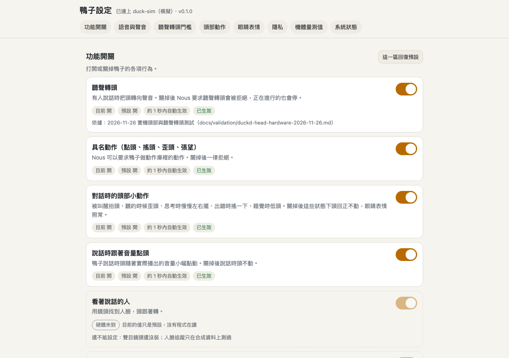 | 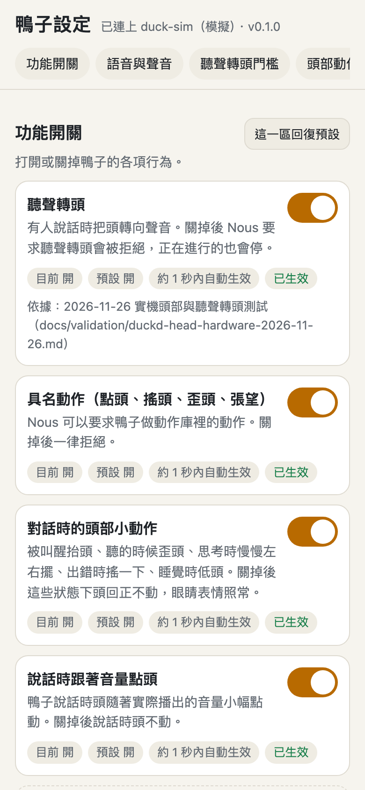 |
| 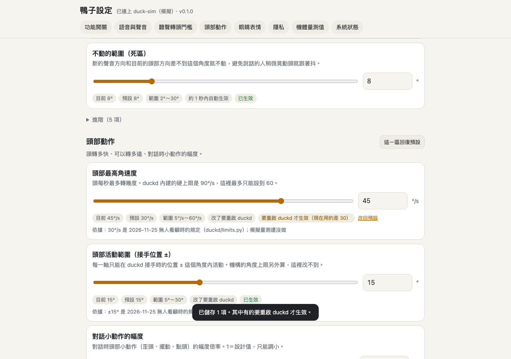 | 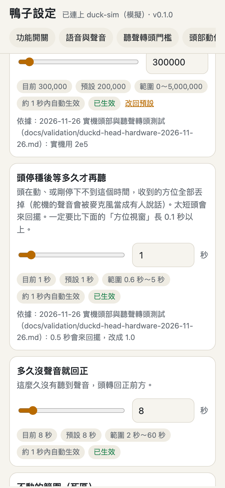 |
| 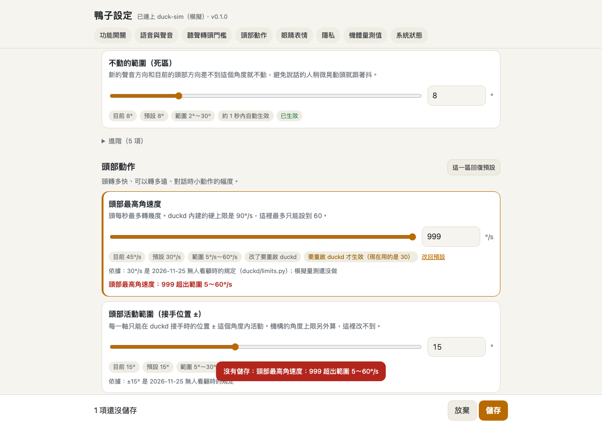 | 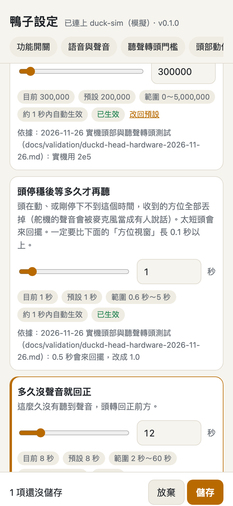 |
| 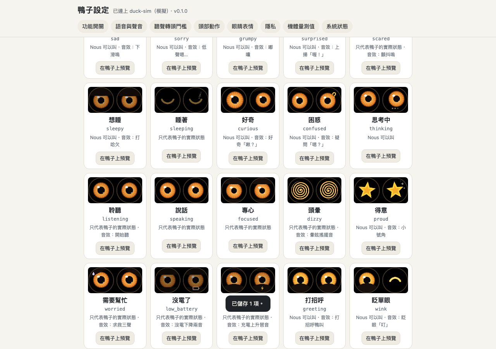 | 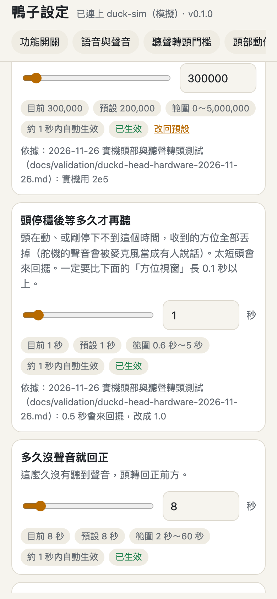 |
| 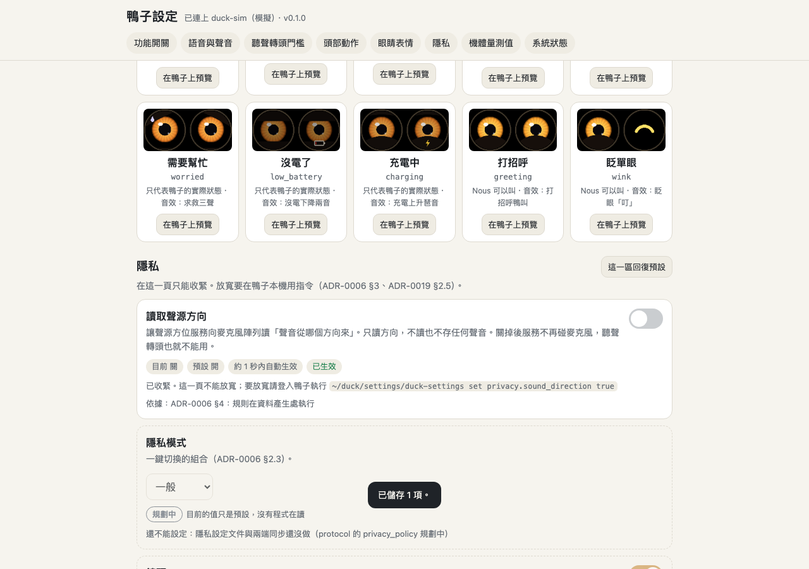 | |
| 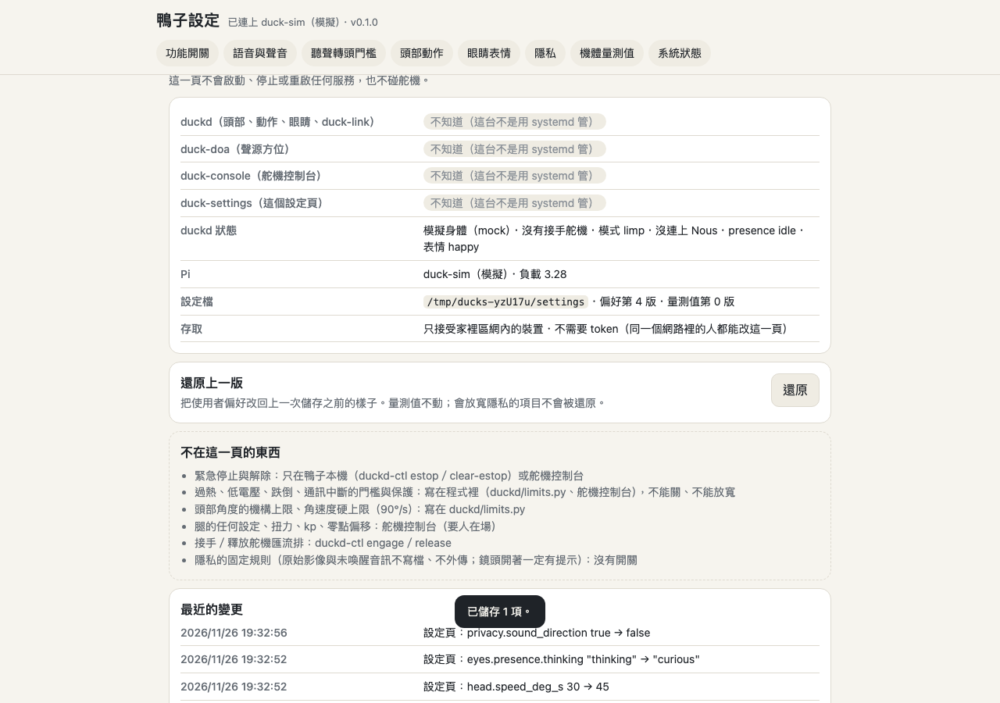 | |

## 4. Pi 上（2026-11-26 晚上，PR #44 併入後補做）

- **驗證層級：實機 Pi 4、家裡區網、從 Mac 用 curl 與無頭瀏覽器。** 只驗證了設定頁本身；**duckd 與 duck-doa 沒有啟動，沒有任何設定在會動的鴨子上生效過**。
- 來源：`v2` 的 `8ff14fd`（PR #44 的合併）。使用者 2026-11-26 在 E 線對話同意「部署並啟動」。
- 沒有碰舵機匯流排、沒有啟動 `duckd`／`duck-doa`、沒有動 `duck-console`、沒有重開 Pi。

### 4.1 部署

```bash
ssh duck-pi4 'cp -p ~/duck/doa/config/doa.json ~/duck/doa/config/doa.json.bak-20261126-pre-settings'
bash nous_duck/robot/deploy/pi4/deploy_settings.sh --start
```

| 檢查 | 結果 |
|---|---|
| `doa.json` 部署前後的 SHA-256 | 相同（`ba40752b0c27766d…`）；備份檔留在同一個資料夾 |
| 搬進設定的值（`import-doa`） | 正前方 176.9°、已校正、`counterclockwise: false`、`mount: head`、能量門檻 200000、`speech_source: energy`、視窗 0.5 s、樣本數 4、分群 25°；`sample_hz`、`publish_hz` 沒有對應的設定，照實列為略過 |
| 停穩等待 | 1.0 秒（這是 schema 的預設值，原本寫在 `duckd/track.py`，不在 `doa.json` 裡） |
| 服務狀態 | `duck-settings` active、**disabled**（沒有設成開機自動啟動）；`duckd`、`duck-doa` inactive；`duck-console` active（前後沒變） |
| 沙箱 | `PrivateDevices=yes`、`ProtectSystem=strict`；服務行程看到的 `/dev` 只有 `null`、`zero`、`random`、`urandom`、`tty`、`pts` 等，**沒有 `ttyACM0`、沒有 I2C、沒有 GPIO**。沙箱沒有擋到 `systemctl is-active`（頁面讀得到四個服務的狀態） |
| 表情預覽 | 25 張都由 Pi 上的 `duck_eyes` 畫出來；第一次請求 3.7 秒（從 Mac 量，含網路） |

### 4.2 從 Mac 經區網（不是 loopback）

用 Pi 的區網 IP 與 `duck-pi4.local` 兩種位址，port 8081。

| 檢查 | 結果 |
|---|---|
| 頁面 | 兩種位址都回 200（28.8 KB）；無頭瀏覽器在 390 px 與 1280 px 開啟，沒有水平捲動，頁面上方顯示「已連上 duck-pi4」，**沒有向外部要任何資源** |
| 讀到的是機上的值 | 正前方校正值 176.9°、已校正、`counterclockwise` 關、`mount` head、能量門檻 200000、停穩 1.0 s、頭部 30°/s、±15°；設定檔沒有問題；Pi CPU 46.3 °C |
| 改一個無害的設定再改回 | 「多久沒聲音就回正」8 → 9（200，偏好第 2 版，回讀是 9）→ 8（200，第 3 版）。Pi 上 `duck-settings get` 回讀 8.0 |
| 變更紀錄 | `changes.jsonl` 兩筆都是 `source: web`、`from` 是 Mac 的區網 IP、有 key 與前後值；部署時的搬移那一筆是 `source: local_cli` |
| 別的網頁的 `Origin` | 403「不接受別的網頁送來的請求」；`Origin: null` 也是 403 |
| 沒有自訂標頭／不是 JSON | 403 |
| 錯的 `Host` | 403 |
| 超出範圍（角速度 200） | 400「超出範圍 5～60°/s」，沒有寫入 |
| schema 以外的 key（`safety.estop`）、未實作的項目（`audio.mute`） | 400，逐項說明，沒有寫入 |
| 被拒絕的請求 | 沒有留下變更紀錄（紀錄只有上面三筆） |

**沒有驗到的**：「非私有來源位址被拒」沒辦法在家裡區網裡實測（從區網送不出公網來源位址），只有單元測試（`test_only_lan_addresses_and_known_hosts`）。沒有從真的手機開過，手機寬度是無頭瀏覽器模擬的。

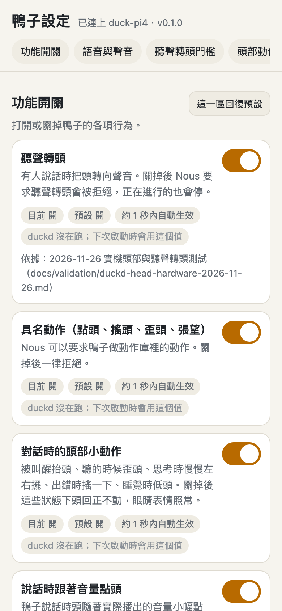

### 4.3 現在頁面上的「生效狀態」要怎麼讀

Pi 上的 duckd 與 duck-doa 還是**舊的部署**（它們的 systemd 單元沒有 `--settings-dir`，`systemctl cat` 確認過）。所以：

- 現在在設定頁改任何東西都**只是存起來**，沒有程式會用。
- 頁面這時顯示「duckd 沒在跑；下次啟動時會用這個值」。**這句話在重新部署之前不成立**：舊的 duckd 啟動後不會讀設定（那時頁面會改顯示「還是舊版程式」）。這是頁面的缺口：它看不出裝在 Pi 上的是哪一版，列為待修。
- 要讓設定真的生效：用 `v2` 重新跑 `deploy_duckd.sh` 與 `setup_doa.sh`（兩支都不會啟動服務），之後啟動 duckd／duck-doa 時就會讀這份設定。這一步屬於 A 線，這次沒有做。

## 5. 限制

- 「已生效」的判斷依賴服務自己的回報與行程是否存在。服務沒在跑時頁面說「下次啟動時會用這個值」，但它看不出 Pi 上裝的是不是會讀設定的版本（§4.3）。
- 「已生效／要重啟」在 Pi 上還沒有看過：那要 duckd 或 duck-doa 用新版在跑。
- 語音與聲音整區、隱私的四項、看人、喚醒詞、音效、螢幕亮度、自動眨眼：只有顯示，沒有程式讀。
- 頭部角速度與活動範圍的可調範圍（5～60°/s、±5～30°）沒有模擬或實機量測支持，只確認了它們在 duckd 的硬上限以內。
- 沒有做負載或長時間測試；沒有兩支手機同時改的實測（只有「版本不同就拒絕」的單元測試）。
