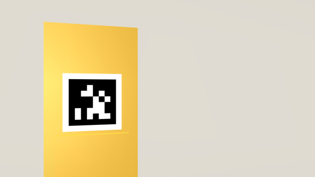
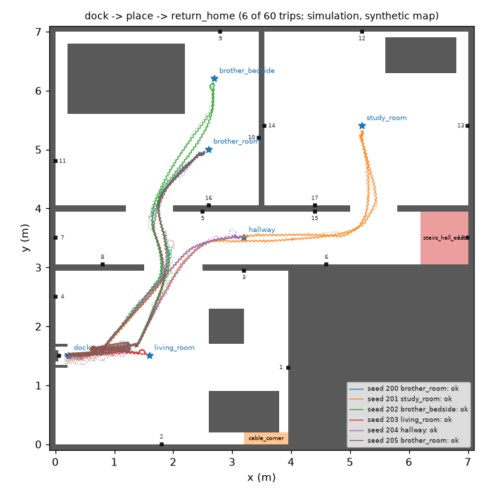

# 驗證紀錄：全身走路模擬與家中導航（C 線，2026-11-25～26）

- 驗證層級：**模擬**（MuJoCo＋上游步態策略）與**單元測試**（運動學 mock）。**沒有實機**：這次完全沒有碰 Pi 與實體鴨子。
- 對象：[`sim/walk_sim/`](../../sim/README.md)、[`sim/nav_sim/`](../../sim/README.md)、[`robot/navigation/duck_nav/`](../../robot/navigation/README.md)。
- 分支：`claude/duck-c-sim-nav-2e1cfa`。設計背景：[ADR-0016](../adr/ADR-0016-navigation-core-and-sim-findings.md)。
- 下面所有數字都是模擬值。mock 的東西：標籤觀測（幾何合成）、障礙點（2D 光線投射）、充電訊號（幾何判定）、地圖（合成的家）。

## 1. 怎麼重現

```bash
cd nous_duck/sim
uv venv --python 3.12 .venv && uv pip install --python .venv/bin/python -r requirements-dev.txt
.venv/bin/python -m pytest tests -q --runslow
(cd ../robot/navigation && ../../sim/.venv/bin/python -m pytest tests -q --runslow)
.venv/bin/python -m walk_sim.measure --out ../docs/validation/data/walk-measure-2026-11-25.json   # 約 3 分鐘
.venv/bin/python -m nav_sim.demo --trips 60 --seed 200 --out nav_demo_out/final60                  # 約 80 秒
.venv/bin/python -m nav_sim.tagcheck --out ../docs/validation/data/tagcheck-2026-11-25.json
```

環境：macOS（Apple 晶片）、Python 3.12.x、mujoco 4.0.1、numpy 2.5.4、onnxruntime 1.32.0、opencv-contrib-python-headless 5.1.0.95。
導航核心另外在 Python 3.11.17＋numpy 2.4.6 跑過同一組測試（鴨子端的版本）。

## 2. 測試結果

| 測試組 | 預設 | `--runslow`（2026-11-26 重跑） |
|---|---|---|
| `nous_duck/sim/tests`（look_at 10、walk_sim 11、nav_sim 10） | 29 通過、2 跳過，約 8 秒 | **31 通過**，54 秒 |
| `nous_duck/robot/navigation/tests`（地圖 6、步態與規劃 13、定位 9、任務 11、安全 27） | 65 通過、1 跳過，約 13 秒 | **66 通過**，21 秒 |

## 3. C1：模型與控制迴圈怎麼對照上游

| 項目 | 做法 | 對照的上游檔案（唯讀查閱，只取數值與組法，沒有複製程式） |
|---|---|---|
| 模型 | `mujoco.MjSpec` 讀本 repo 的 `mini_bdx/robots/open_duck_mini_v2/robot.xml`（不改原檔），補浮動機身、IMU site、陀螺儀與加速度計、鞋底碰撞、地板 | Open_Duck_Playground `b9be205`：`xmls/open_duck_mini_v2.xml`、`scene_flat_terrain.xml` |
| 舵機與關節 | kp 13.37、力矩 ±3.23 N·m、阻尼 0.56、摩擦 0.068、轉子慣量 0.027；地板摩擦 0.6 | 同上（`sts3215` 類別） |
| 起始姿勢 | `home` keyframe，機身高 0.15 m | Playground `home`；與 runtime `376de65` `rustypot_position_hwi.py` 的 `init_pos` 相同 |
| 觀測（101 維） | 陀螺儀 3、加速度計 3（x 加 1.3）、指令 7、關節角 − 起始姿勢 14、關節速度 × 0.05 14、前三次動作 42、上一圈馬達目標 14、足底接觸 2、相位 (cos, sin) 2 | runtime `scripts/v2_rl_walk_mujoco.py` `get_obs()`；Playground `mujoco_infer.py` `get_obs()`、`joystick.py` `_get_obs()` |
| 動作 | 目標 = 起始姿勢 + 0.25 × 輸出；每圈變化限 5.24 rad/s × 0.02 s | 同上 |
| 相位 | 一個週期 27 個控制步（0.54 s × 50 fps，取自 `polynomial_coefficients.pkl` 的 `period`、`fps`） | `poly_reference_motion.py` |
| 頭部指令 | 預設照 runtime：加在策略輸出的頭部目標上，而且留在 `motor_targets` 進下一圈觀測 | runtime `run()` |

**交叉檢查**：同一個控制迴圈換成 Playground 自己的場景 XML（放在暫存目錄、不進 repo），以及它的背隙版場景，行為跟我們組的模型同量級：

| 指令 | 我們的模型 | Playground 場景 | Playground 背隙場景 |
|---|---|---|---|
| 站立 5 秒 | 不踏步、不位移 | 相同 | 相同 |
| vx 0.15 | 0.110 m/s | 0.092 | 0.125 |
| vx 0.10 | 0.059 | 0.031 | 0.069 |
| vx 0.05、vx −0.10、vy 0.10 | 留在原地 | 留在原地 | 留在原地 |
| yaw 1.0 | 0.81 rad/s | 0.79 | 0.94 |

所以「小指令不起步」來自策略與控制迴圈本身，不是模型組錯。**沒有調任何參數去讓它「看起來會走」。**

已知跟訓練用模型不同：沒有背隙關節；本 repo 的模型含天線關節，總質量 2.062 kg（Playground 2.107 kg）；求解器用 MuJoCo 預設（`solver="playground"` 可切成 Playground 的設定，vx 0.15 時實際速度會從 0.110 降到 0.069 m/s）；多了只跟牆碰撞的機身與頭部外殼。

## 4. C2：走、停、轉的量測

完整數字：[`data/walk-measure-2026-11-25.json`](data/walk-measure-2026-11-25.json)。每個指令從站立開始、在 9 個不同的步態相位下指令。

### 4.1 指令速度 vs 實際速度（只給單一軸）

| 指令 | 起步（9 次中） | 實際 | 比例 |
|---|---|---|---|
| vx +0.15 | 9 | 0.115 m/s | 0.77 |
| vx +0.12 | 9 | 0.095 | 0.79 |
| vx +0.10 | 9 | 0.072 | 0.72 |
| vx +0.08、+0.05、+0.03 | 0 | 留在原地 | — |
| vx −0.15 | 9 | −0.052 | 0.35 |
| vx −0.12 | 9 | −0.045 | 0.37 |
| vx −0.10、−0.08、−0.05 | 0 | 留在原地 | — |
| vy +0.20 | 9 | 0.115 | 0.57 |
| vy 其他（±0.05～0.15、−0.20） | 0 | 留在原地 | — |
| yaw ±1.0 | 9 | +0.83／−0.88 rad/s | 0.83／0.88 |
| yaw ±0.6 | 9 | +0.50／−0.40 | 0.84／0.66 |
| yaw +0.3 | 9 | 0.18 | 0.60 |
| yaw −0.3、±0.15 | 0 | 留在原地 | — |

前後速度達到門檻（|vx| ≥ 0.10 前進、≤ −0.12 後退）時，**同時加任何轉向都會起步**（36 種組合 × 9 相位全部起步）。導航因此只用：前進 0.15、後退 −0.15、原地轉 ±1.0／±0.6，轉向連續可調，不用側移。

已經在走時把指令降到門檻以下：vx 0.08 幾乎都停下（9 次只有 1 次還在走）、vx −0.10 會繼續慢慢退、yaw +0.3 繼續轉、yaw −0.3 停下。

### 4.2 起步、停下、轉身

| 項目 | 結果 |
|---|---|
| 速度指令為 0 | **不踏步**，兩腳一直著地（20 秒漂移 1.1 cm、1.7°）。ADR-0009 §2.5 假設的原地踏步在模擬裡沒有出現 |
| 起步（vx 0.15） | 第一步 0.17 s；到穩態 90% 平均 1.5 s（最大 1.6 s）、走了 0.18 m；加速度限制下 1.7 s（最大 1.9 s） |
| 停下（指令歸零 → 兩腳著地持續 0.3 s） | 平均 0.54 s（最大 0.74 s）、滑行 1.7 cm（最大 3 cm）；加速度限制下 0.66 s、3.1 cm（最大 4 cm） |
| 原地轉 90° | yaw 1.0：約 2.0～2.1 s、位移 5～10 cm、超過 4°（最大 7°）；yaw 0.5：3.9～5.6 s |
| 原地轉 180° | yaw 1.0：約 3.8～4.0 s、位移 7～12 cm |
| ADR-0009 加速度限制 | 一連串急換指令，有無限制都沒有跌倒，最大傾角 7.6°／7.9° |

### 4.3 多種子的跌倒率

每個種子 60 秒，每 2～5 秒換一次隨機指令，加訓練等級的感測雜訊（陀螺儀 0.1、加速度計 0.05）與起始擾動。

| 條件（各 40 個種子） | 跌倒 | 最大傾角 |
|---|---|---|
| 上游範圍、指令直接跳 | 0 | 7.7° |
| 上游範圍、ADR-0009 加速度限制 | 0 | 8.3° |
| 室內上限（vx 0.10、vy 0.10、yaw 0.6）、加速度限制 | 0 | 7.2° |
| 機身加 0.2 kg | 0 | 7.6° |
| 機身加 0.4 kg | 0 | 7.6° |
| 地板摩擦 0.3 | 0 | 7.7° |

注意：室內上限 vx 0.10 剛好是前進的起步門檻，再低就走不動。

### 4.4 頭部指令

頭以 1 rad/s 慢慢轉到目標再維持 6 秒（runtime 的接法）。

| 頭部指令 | 站著 | 走路（vx 0.15） |
|---|---|---|
| head_yaw +0.3、+0.5 | 穩定 | 穩定，速度不變 |
| head_yaw +0.8～+1.5 | 穩定 | 不跌倒，但**步態停下來**（速度 ≈ 0） |
| head_yaw −0.5 | 穩定 | 步態停下來 |
| head_yaw −1.0、−1.5 | **跌倒** | **跌倒** |
| neck_pitch +0.9、+1.1 | **跌倒** | **跌倒** |
| neck_pitch −0.34 | 穩定 | **跌倒** |
| neck_pitch +0.3、+0.6 | 穩定 | 步態停下來 |
| head_pitch ±0.4～±0.78 | 穩定 | 步態停下來 |
| head_roll ±0.5 | 穩定 | 速度下降 |

另一種接法（頭部指令只進觀測、不加在目標上）時，頭完全不跟指令走，所以實機的頭部動作靠的是 runtime 加上去的那一段。
導航因此規定：**走路時頭回正，停下才轉頭，而且只轉 ±0.5 rad。** 這些是模擬結果，但在實機驗證前應該當成限制。

### 4.5 為什麼不能只靠指令積分或步數（ADR-0002 的前提）

同一段指令（前進 10 s → 轉 2.6 s → 前進 10 s → 側移 5 s，實際走約 3～4 m）：

| 條件 | 指令積分的終點誤差 | 航向誤差 | 步數估計的路徑長誤差 |
|---|---|---|---|
| 名目 | 0.19 m（最大 0.21） | 8.6° | 0.03 m（步長就是在這個條件下量的） |
| 地板摩擦 0.3 | 0.23（0.34） | 8.7° | **0.70 m**（最大 0.90） |
| 地板摩擦 1.0 | 0.28（0.31） | 4.7° | 0.03 |
| 機身加 0.2 kg | 0.23（0.26） | 8.6° | 0.07 |
| 舵機增益少 20% | **0.53**（0.54） | 12.1° | **0.59**（0.81） |

走 4 m 就差 0.2～0.5 m，而且條件一變（地板、負重、電壓造成的增益變化）誤差就換一個樣子。所以定位以標籤為主，里程只補空檔，而且過程雜訊給得很大。

## 5. C3：地圖

- 格式 `duck-map` 第 1 版：欄位定義在 [`duck_nav/mapfile.py`](../../robot/navigation/duck_nav/mapfile.py) 檔頭。
- 合成的家 [`maps/synthetic_home.duckmap.json`](../../robot/navigation/maps/synthetic_home.duckmap.json)（`synthetic: true`，由 `make_synthetic_home.py` 產生，測試會確認兩者一致）：7 × 7 m、4 個房間、3 扇門、6 個地點、樓梯禁區與一個 no_go 區、19 個 tag36h11、充電座。**不是任何真實住家的格局。**
- 驗證器會擋：不支援的版本、沒有樓梯禁區也沒宣告 `no_stairs`、ID 不合格式、地點落在占據格或禁區、標籤重複、門連到不存在的房間、柵格大小不符、充電座標籤不存在。
- 充電座的標籤（ID 0、黑框 100 mm、離地 340 mm）與「機身原點到觸點面 0.162 m」由測試對照 `hardware/dock/cad/dock_cad/params.py` 與上游 `robot.xml`。

## 6. C4：定位

- 擴展卡爾曼濾波（x、y、yaw）：預測用「實際送出的速度指令 → 步態反應表」＋陀螺儀偏航；更新用標籤在機身座標的位姿。**沒有步數輸入**（測試檢查介面）。
- 看不到標籤時不確定度持續成長：以 0.115 m/s 走 60 秒後超過「未定位」門檻（位置 σ 0.30 m），上層停下。
- 綁架：身體端回報被抱起來就丟掉定位；沒有回報時，觀測連續 2 次對不上先標成不可信（停下），連續 6 次且反推位姿一致才重新初始化。
- 閉迴路追蹤誤差：MuJoCo 60 趟裡估計與真實位置的最大差距 0.19 m。

**相機算圖＋真的偵測器**（[`data/tagcheck-2026-11-25.json`](data/tagcheck-2026-11-25.json)）：MuJoCo 頭上相機（1280×720、垂直視角 39.4°）算圖，OpenCV `DICT_APRILTAG_36h11` 偵測＋`solvePnP`。

| 項目 | 結果 |
|---|---|
| 9 個位置的偵測次數 | 13 |
| 位置誤差（機身座標） | 平均 0.7 cm、最大 2.4 cm |
| 標籤朝向誤差 | 最大 6.9° |
| 預備點（離充電座標籤 0.56 m） | 讀到 ID 0，邊長 188 px，位置誤差 0.9 mm |
| 跟 mock 觀測「看得到哪些標籤」一致 | 7／9；不一致的 2 個位置都是真的偵測器多讀到（斜角 70° 以上、3.7 m 遠） |



算圖沒有鏡頭畸變、動態模糊、曝光與雜訊，所以這只說明 mock 的幾何與誤差量級合理、而且偏保守，**不代表實機的偵測率或精度**。

## 7. C5～C6：端到端

`python -m nav_sim.demo --trips 60 --seed 200`（種子 200～259 沒有拿來調參數）。每趟：從充電座出發 → `go_to` → `return_home`。
結果檔：[`data/sim-nav-roundtrips-2026-11-25.json`](data/sim-nav-roundtrips-2026-11-25.json)。



| 項目 | 結果 |
|---|---|
| 來回成功 | **60／60** |
| `go_to` 到達 | 60／60，到達誤差最大 0.18 m（容許 0.12 m 是以估計位置判斷） |
| `return_home`（mock 充電訊號） | 60／60：第 1 次就成功 50、第 2 次 8、第 3 次 2 |
| 跌倒 | 0（最大傾角 8.2°） |
| 離禁區最近 | 0.76 m |
| 定位誤差最大 | 0.19 m |

| 目的地（各 12 趟） | 去程平均 | 回程平均（含回充） |
|---|---|---|
| `living_room` | 11.7 s | 35.4 s |
| `hallway` | 33.7 s | 58.5 s |
| `brother_room` | 41.4 s | 79.0 s |
| `brother_bedside` | 52.9 s | 66.4 s |
| `study_room` | 70.1 s | 96.6 s |

**回充對位誤差**（背後觸點面第一次進 V 形導引座開口時），對照充電座 CAD 的捕捉範圍 ±34 mm、±5°（[`dock-cad-2026-11-13.md`](dock-cad-2026-11-13.md)）：

| | 平均 | 標準差 | 最大 |
|---|---|---|---|
| 橫向 | +16.5 mm | 16.8 mm | 45.4 mm |
| 偏航 | −0.77° | 0.85° | 2.48° |

- 60 次裡 50 次第一次就在捕捉範圍內；偏航都在範圍內，**超出的都是橫向**。
- 橫向校正量 −29 mm 是用種子 0～19 量的；在新的種子上平均還剩 +16.5 mm，表示這個校正量本身就不穩，實機一定要重量。
- 失敗案例分析：沒有最終失敗的趟次。第一次沒對準的 10 趟，原因都是倒退是盲退（鏡頭看不到充電座），位置靠陀螺儀航向與步態反應表推算；轉身 180° 的位移與倒退時的側滑每次不完全一樣。
- 運動學 mock（加 8% 的步態模型誤差、30 個種子）：含重試 23／30 成功，第一次就成功 19／30。模型誤差是每個種子固定的，所以重試常常錯在同一邊，這是盲退方案的先天限制。

沒有模擬的：V 形導引座把鴨子推回中間的過程、頂針彈力、鴨子被側推時的平衡、任何電氣行為。「開始充電」在模擬裡是幾何判定的 mock 訊號，事件裡標 `signal: mock`。

## 8. C7：安全規則

每條規則都有運動學 mock 的單元測試；標 ✔ 的另外有 MuJoCo 測試。

| 規則 | 測試怎麼驗 | MuJoCo |
|---|---|---|
| 禁區永遠不進入 | 路徑離禁區 ≥ 0.45 m；6 個種子去離樓梯最近的書房，真實位置離禁區 > 0.35 m | ✔（> 0.45 m） |
| 目的地在禁區保留邊界內 | 不出發，回報 `forbidden` | |
| 估計位置離禁區太近 | 距離 < 0.20 m ＋ 不確定度就立刻停、回報 `forbidden`；不確定度越大越早判定 | |
| 定位漂移（關掉所有標籤） | 4 個種子都在不確定度過大時停下、回報 `lost`，離禁區 > 0.30 m、沒有撞牆 | |
| 未定位時不前進 | 只會原地轉身找標籤；找不到回報 `lost` | |
| 被抱到別的房間 | 丟掉定位、原地找標籤、重新規劃後到達（4 個種子至少 3 個到達）；未定位期間位移 < 0.3 m | ✔ |
| 門關著 | 走到門前 0.5 m 停下，回報 `door_closed`（帶門的 ID）；沒有頂到門板；不影響去別的房間 | ✔ |
| 被擋住 | 房間裡的箱子：重新規劃繞過；走廊整個堵住：有限次數後回報 `blocked` | ✔ |
| 步態沒起步 | 送了指令腳沒動，3 次後回報 `blocked` | |
| 跌倒 | 立刻結束任務，回報 `fell`，速度歸零 | |
| 逾時、取消 | 回報 `timeout`／`cancelled`，速度歸零 | |
| 指令範圍 | 整趟任務只送 vx ∈ {0, ±0.15}、vy = 0、|yaw| ≤ 1.0；走路時頭回正 | |

已知限制：身體端**沒有**回報被抱起來時，鴨子會照舊的估計繼續走，直到標籤觀測對不上才停。測試確認這種情況下仍不會走進禁區，但那是靠牆擋著；實機一定要有 `picked_up` 的偵測。

## 9. 模擬與實機的差距

| 項目 | 模擬裡的假設 | 實機會怎樣 |
|---|---|---|
| 質量 | 上游 CAD 2.06 kg；另外試過機身加 0.2／0.4 kg 的點質量 | Pi 4、鏡頭、喇叭、觸點板的實際重量與位置還沒量；重心改變的影響沒有模擬 |
| 舵機 | 理想的位置控制＋固定增益、摩擦、力矩上限 | 背隙、溫度、電壓下垂、通訊延遲；模擬裡增益少 20% 速度就少約 3 成 |
| 地面 | 平坦、單一摩擦係數 | 地毯、門檻、磁磚縫、地板接縫 |
| 足底接觸 | 幾何碰撞直接得到 | 足底開關（還沒接）；彈跳與誤觸發 |
| IMU | 理想感測值＋小雜訊 | BNO055 還沒校準、裝機方向未確認 |
| 標籤觀測 | 幾何合成；真的偵測器只在無雜訊的算圖上驗過 | 光線、模糊、反光、走路時的晃動；偵測率與精度都要實測 |
| 障礙 | 2D 光線投射，只看得到地圖上有高度的東西 | 雙目深度（基線 52 mm）在近距離才準；地上的小東西、玻璃、落差都沒模擬 |
| 充電座 | 一個停止面＋幾何判定的 mock 訊號 | V 形導引、頂針、電氣握手都還沒做出來 |
| 起步門檻、速度比例、頭部安全範圍 | 這份紀錄的數字 | **要在實機上重量**；這些直接決定導航能用哪些指令 |

## 10. 沒做的

- 沒有任何實機驗證。
- 沒有背隙關節的模型（只用 Playground 的背隙場景做過起步門檻的對照）。
- 沒有做 VIO 或視覺里程；短程里程是步態反應表＋陀螺儀的替身。
- 沒有做「太暗就不走」、落差偵測、跨樓層、地圖建立工具（帶看模式）。
- 沒有跟 A 線的 `duckd` 實際接起來；介面寫在 [`robot/navigation/README.md`](../../robot/navigation/README.md)。
