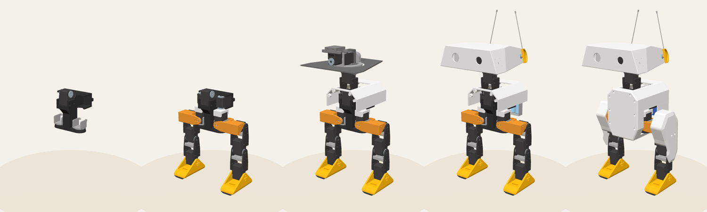

# 組裝檢視器 BOM 與組裝步驟驗證（2026-11-13）

| 項目 | 內容 |
|---|---|
| 分支 | `claude/viewer-bom-steps`（從 `v2` 的 `f5219c6` 開出） |
| 環境 | 雲端容器（Ubuntu 24.04、Python 3.13.18） |
| 驗證層級 | 單元測試、無頭瀏覽器目視檢查（Playwright Chromium＋SwiftShader WebGL 2.0）。**沒有實機驗證**，BOM 與步驟也還沒有在實際組裝中使用過。 |
| 資料檔 | `nous_duck/assembly_viewer/data/bom.yaml`、`steps.yaml` |

## 執行的指令

```bash
cd nous_duck/assembly_viewer/pipeline
python -m viewer_pipeline
python -m pytest ../tests/pipeline -v
```

**72 項測試全部通過**：上一批的 45 項，加上這一批新增的 27 項。建置 1.77 秒。

## 結果

| 項目 | 數字 | 怎麼算的 |
|---|---|---|
| BOM | 71 項 | 列印件 36 種（自動產生），加上 `bom.yaml` 的 35 項 |
| 依類別 | 列印件 36、電子 10、五金 7、電源 6、線材 4、材料 3、接頭 2、舵機 2、工具 1 | 依 `category` 計數 |
| 對上上游 BOM | 29 列，每列剛好被引用一次 | 測試讀 `nous_duck/docs/handoff/upstream_bom.csv`，找出所有「有零件名稱和數量」的列，逐列比對名稱、數量、單價 |
| 3D 零件的 BOM 歸屬 | 138 個零件都剛好屬於一項 | 136 個屬於 BOM 項目，2 支天線列在 `cad_without_bom` |
| 有 3D 的 BOM 數量 | 全部一致 | 例如 STS3215 是 14 顆（70 個網格）、18650 電池 2 顆、軸承 3 顆 |
| 組裝步驟 | 17 步，其中 1 步選配 | 依上游組裝說明 |
| 每個零件裝上的步驟 | 138 個零件都剛好裝一次 | 各步裝上的數量：0、11、18、16、16、24、7、15、1、1、6、10、0、0、6、7、0，合計 138 |

## 舵機在哪一步裝上

照上游組裝說明，測試會鎖住這個對應：

| 步驟 | 舵機 ID | 上游依據 |
|---|---|---|
| 主軀幹 | 30 | 「Mount the middle motor」 |
| 兩隻腳 | 14、24 | 腳踝舵機裝在 foot_top 那一側 |
| 小腿 | 13、23 | 小腿上端的膝舵機 |
| 大腿 | 12、22 | 「the hip_pitch motor is mounted this way」 |
| 髖部 | 10、11、20、21 | 髖偏航與髖側擺 |
| 頸部 | 31 | 頸部上端 |
| 頭部關節 | 32、33 | 頭部偏航與側擺 |

## 目視檢查

我用上一批的臨時 three.js 頁面（沒有提交），加上「只顯示到第 N 步為止裝上的零件」，截了 5 張圖，頁面都沒有錯誤：



由左到右：

1. 主軀幹完成：軀幹、ID 30、兩個髖側擺下座。
2. 髖部完成：兩條腿已裝上。
3. 頭部關節完成：頸部與頭部關節；頭部底板和機身中段上殼照上游建議先套上。
4. 頭部完成：頭殼、天線、電池組。
5. 機身外殼完成：前後殼與腿部側蓋。

## 錯誤會被擋下

測試會故意餵入寫錯的資料，確認建置失敗並說明原因：

- 數量和 3D 模型不符
- 同一個零件被兩個 BOM 項目引用
- 有零件不屬於任何 BOM 項目
- 3D 中沒有的零件沒寫原因
- 缺少英文翻譯
- 選擇器打錯網格名稱
- 零件在兩個步驟都裝上
- 零件沒有在任何步驟裝上
- 步驟引用不存在的 BOM 項目
- 參考圖不存在
- 中英文操作的項目數不同

## 和上游不同的地方

1. **配線移到頭頸接合之後。** 上游把接線圖放在 IMU 之後、電池組與頭部之前，但實際接線需要 Pi Zero 已經裝上。
2. **腿部側蓋放在最後裝外殼時。** 上游沒有寫何時裝；依 CAD 它們固定在大腿上。

兩處都寫在步驟的 `deviation_zh`／`deviation_en`。

## 上游沒寫、這裡也不補的事

| 事項 | 上游的情況 | BOM／步驟的處理 |
|---|---|---|
| 足底開關每隻腳幾顆 | BOM 寫 4 顆，腳位表每腳只有一個訊號腳位 | 照實寫出兩邊的說法 |
| 其他 M3 螺絲 | 組裝說明寫「X m3 screws (TODO)」 | 數量寫 `null` 並說明 |
| M3 熱熔螺母總數 | BOM 是「一包」 | 數量寫 `null` 並說明 |
| XT30 或 XT15 | BOM 原文「XT15? XT30 ?」 | 照抄原文並說明 |
| 兩條 USB 線各接哪裡 | 沒寫 | 照實寫出 |
| 軸承型號 | 沒寫 | 只寫 CAD 量到的尺寸（外徑 32 mm、厚 7 mm） |
| 舵機驅動板的安裝照片 | 原文「TODO take a photo」 | 請對照 3D 模型 |
| 表情配件的組裝步驟 | 原文「TODO add instructions」 | 列為選配步驟，只寫腳位表裡有的接線 |

## 限制

- **參考圖要連網才看得到**：步驟附的上游照片是 GitHub 附件網址，在本專案的雲端環境下載會回 403，所以沒有內嵌。repo 內的接線圖（2 張）之後可以由前端內嵌。
- **示意形狀**：CAD 沒有的零件（足底開關、喇叭、LED、線材、螺絲）只列在 BOM，3D 中不畫示意形狀。
- **英文說明的審閱**：英文是逐句對應中文寫的，還沒有請英文使用者審閱。
