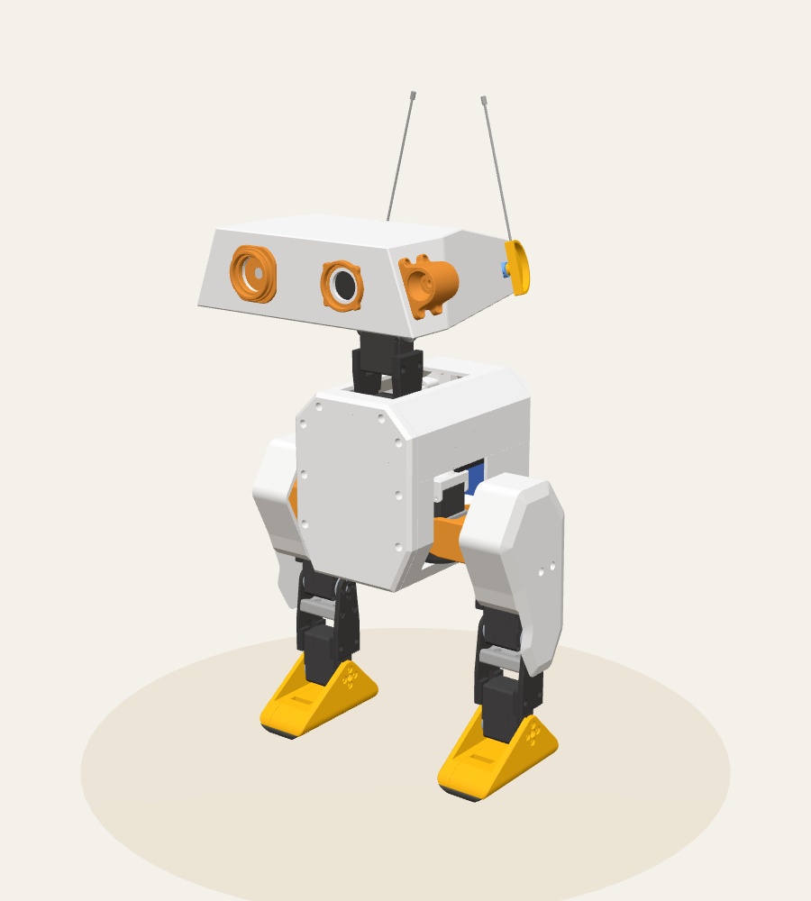
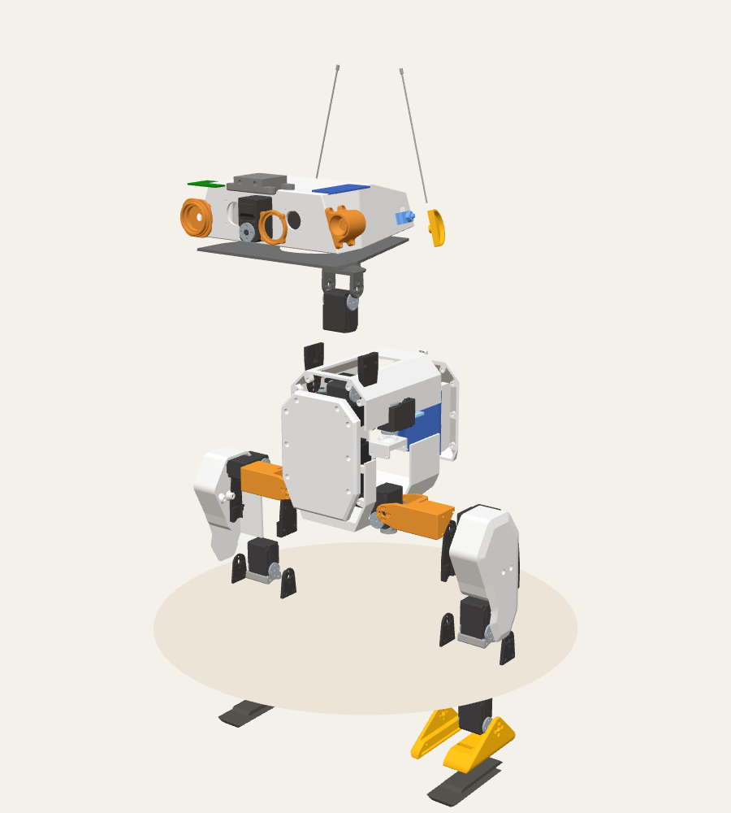

# 組裝檢視器 pipeline 驗證（2026-11-13）

| 項目 | 內容 |
|---|---|
| 分支 | `claude/viewer-pipeline`（從 `v2` 的 `60da3da` 開出） |
| 環境 | 雲端容器（Ubuntu 24.04、Python 3.13.18） |
| 驗證層級 | 單元測試、MuJoCo 交叉驗證、無頭瀏覽器目視檢查（Playwright Chromium＋SwiftShader WebGL 2.0）。**沒有實機驗證。** |
| 依賴 | `numpy==2.5.3`、`PyYAML==6.0.3`；測試加 `pytest==9.2.0`、`mujoco==4.0.1` |

## 執行的指令

```bash
cd nous_duck/assembly_viewer/pipeline
pip install -r requirements-dev.txt
python -m viewer_pipeline
python -m pytest ../tests/pipeline -v
```

依賴是在全新的虛擬環境，從鎖定檔重新安裝的，模擬 CI 的情況。結果是 **45 項測試全部通過**，建置約 2 秒。

## 結果

| 項目 | 數字 | 怎麼算的 |
|---|---|---|
| 零件實例 | 138 | robot.xml 的 131 個 geom，加上 CAD 沒有擺放位置的 7 件列印件 |
| 依類別 | 列印件 51、STS3215 組成網格 70、電子 9、電源 3、軸承 3、其他（天線）2 | 依 `data/cad_parts.yaml` 分類後計數 |
| 列印件 | 51 件、36 種 | 依檔名計數，和上游 `docs/print_guide.md` 逐項相同 |
| STS3215 | 14 顆 | 每顆 5 個網格；ID 和上游 `docs/configure_motors.md` 逐項相同 |
| 舵盤到轉軸 | 每顆都小於 0.0001 mm | 主動舵盤外框中心到關節轉軸的垂直距離 |
| 舵盤到關節點 | 每顆都是 2.525 mm | 同上，到 MuJoCo 關節錨點的距離 |
| 分辨度 | 次近的舵盤至少 44.2 mm 遠 | 每個關節到「另一顆最近舵盤」的距離；對應結果不是勉強選出來的 |
| 高度 | 430.1 mm（不含天線）、518.5 mm（含天線） | 零位姿態的世界外框；原作者說「腿伸直約 42 cm」 |
| 運動樹 vs MuJoCo | 最大差異 < 1 µm | 131 個 geom 的世界外框逐一比對；16 個關節的錨點與轉軸也比對 |
| 網格 | 52 種、412,038 個三角形，`meshes.bin` 3,703,692 bytes | 同一種網格只存一份 |
| 量化誤差 | 最多 0.0015 mm | 每個網格從 `meshes.bin` 解回，和上游原始 STL 逐點比對 |
| 重現性 | 兩次建置逐位元組相同 | 測試直接比對兩次輸出 |

## 目視檢查

我在 scratchpad 寫了一個最小的 three.js 頁面，用 Playwright 載入 `scene.json` 和 `meshes.bin` 截圖。這個頁面**沒有提交**，正式前端是下一批的工作。目的是確認輸出的位置和四元數在 three.js 裡的解讀方式正確，三次截圖的頁面都沒有錯誤。

| 組裝 | 爆炸 |
|---|---|
|  |  |

橘色的是 CAD 沒有擺放位置、套用頭殼座標的 7 件。其他零件的顏色取自 robot.xml。

- 鴨子站立，腳底貼地。
- 眼睛和投射燈在頭部前方與側面。
- 正面視角下，左眼出現在畫面右邊（鴨子面向鏡頭），左右沒有顛倒。

## 驗證中發現的事（對組裝有用）

1. **左右腿用同一套零件，右腿小腿與腳是轉 180°，不是鏡像。** 所以膝、踝舵機（ID 13、14、23、24）在**左腿裝在外側、在右腿裝在內側**。髖部三顆（偏航、側擺、俯仰）則左右對稱。CAD 裡兩條腿都用 `left_knee_to_ankle_*_sheet` 網格，`knee_and_ankle_assembly_3`、`_4` 的旋轉也印證了這點。
2. **頸部的兩顆舵機（ID 30、31）舵盤偏在頸部一側**，離中線 16.6 mm，不在中線上。
3. **CAD 的兩片「board」是同一個通用電路板外形。** 依上游接線圖，機身內的是舵機驅動板，頭部內的是 UBEC 5V 降壓模組，位置和 CAD 一致。這是推定，資料裡有標明。
4. **上游 `print/` 的 STL 和 CAD 網格匯出在同一座標系**：頭殼、軀幹、腳的外框數字完全相同，CAD 只是單位換成公尺。所以 CAD 沒有擺放位置的 7 件可以用頭殼的變換來擺。這也是推得的位置，資料裡標成 `print_frame`。
5. **`antenna` 網格（2 個）不在列印清單，也不在 BOM。** 材質和取得方式上游沒有說明。
6. **軸承 3 顆，外徑 32 mm、厚 7 mm**（量自 CAD 網格），和上游 BOM 的「Bearing ×3」數量一致。BOM 沒有寫型號，這裡也不寫。

## 限制

- CAD 沒有的零件（足底開關、喇叭、LED、線材、螺絲、熱熔螺帽）這一批還沒加。
- 爆炸距離是固定值，前端批次再調。
- 只有零位姿態。
- 目視檢查用的是 SwiftShader 軟體算圖，不代表實機瀏覽器的效能。
