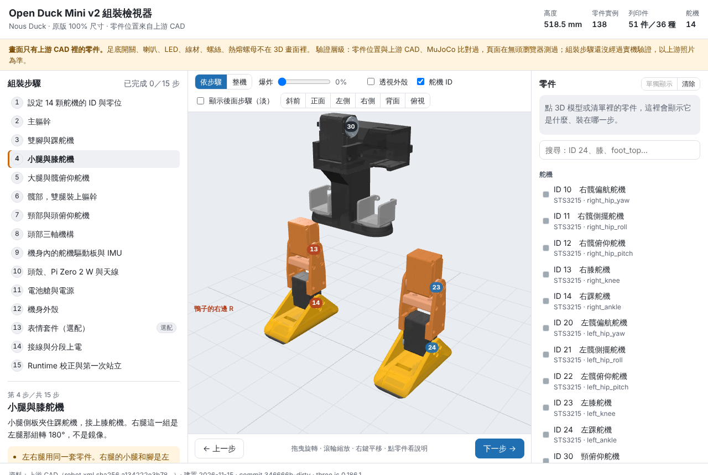
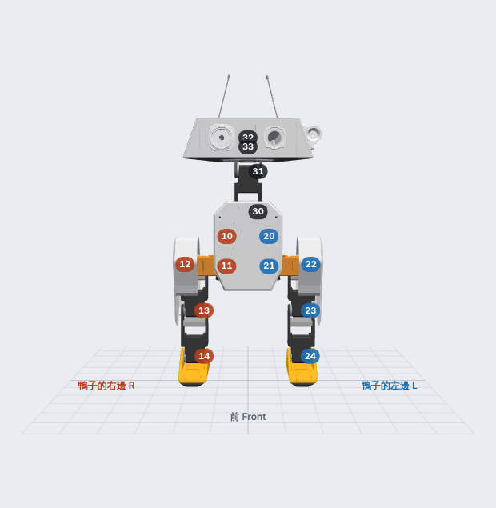
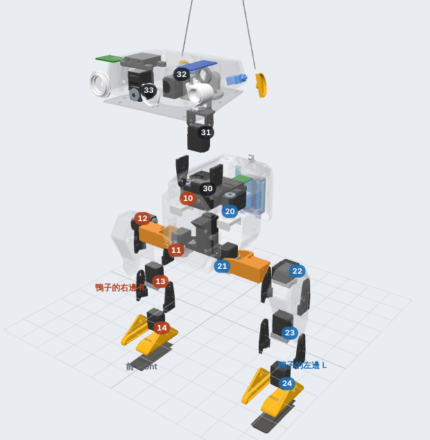
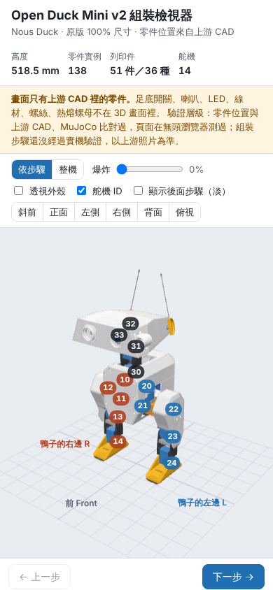

# 組裝檢視器前端與組裝步驟驗證（2026-11-15）

| 項目 | 內容 |
|---|---|
| 分支 | `claude/ecstatic-allen-0hagr1`（從 `v2` 的 `346666b` 開出） |
| 環境 | 雲端容器（Python 3.13.18、Node.js 22.23.4、Playwright 1.63.0 內建 Chromium） |
| 驗證層級 | 單元測試（pipeline＋步驟資料）、無頭瀏覽器（Playwright Chromium＋SwiftShader WebGL 2.0，斷網開啟）。**沒有實機驗證**，組裝步驟也還沒有人照著實際組過。 |
| 依賴 | 前端：`three@0.186.1`；建置：`esbuild@0.28.2`、`typescript@6.0.3`、`@types/three@0.186.0`（鎖在 `web/package-lock.json`） |

這一批做兩件事：

1. 核對 ChatGPT 版檢視器的右腿是否畫對（使用者要求）。
2. 本 repo 自己的檢視器：組裝步驟資料（`data/steps.yaml`）與前端（`web/`），輸出單一 HTML。

## 1. ChatGPT 版的零件擺放核對

### 作法

[`tools/compare_chatgpt_viewer.py`](../../tools/compare_chatgpt_viewer.py) 從 ChatGPT 版 HTML 抽出內嵌的 `DATA`，逐件和本 repo pipeline 的 `scene.json` 比對：

1. 兩邊都用上游 STL 的本地座標（毫米），加上各自的位置與四元數擺放。先用 `trunk_bottom` 求兩邊座標系之間的變換。
2. 每個 ChatGPT 實例取 STL 頂點（每個網格抽樣約 400 點）擺到世界座標，和本 repo 同一種網格的每個實例比對，取最小的「最大頂點誤差」。CAD 沒有擺放位置的 7 件改用上游 `print/` 的 STL。
3. 對上的實例再比對舵機 ID。
4. 列出膝、踝、髖俯仰舵機主動舵盤的 x 座標（+X 是鴨子的左邊），看左右腿是否是 180° 而不是鏡像。

```bash
cd nous_duck/assembly_viewer/pipeline && python -m viewer_pipeline && cd -
python3 -I nous_duck/tools/compare_chatgpt_viewer.py
```

### 結果

| 項目 | 結果 |
|---|---|
| 座標系 | 兩邊軸向相同，ChatGPT 版只差平移 (0.025, 0, −22.3) mm（它沒有把前後置中） |
| 網格實例 | 兩邊都是 138 個，**一對一全部對上** |
| 最大頂點誤差 | 0.0005 mm（容許 0.01 mm；ChatGPT 版的座標四捨五入到 0.001 mm） |
| 舵機 ID | 14 顆全部相同 |
| ChatGPT 版另外的示意零件 | 21 類沒有 CAD 網格的零件（螺絲、熱熔螺母、線材、足底開關、LED、喇叭、麥克風、相機等），它的介面標為「位置或外形示意」或「配線路徑示意」，不在本次比對範圍 |

主動舵盤 x 座標（本 repo 座標；兩條腿的中心約在 ±91 mm）：

| ID | 關節 | 本 repo | ChatGPT 版 | 位置 |
|---:|---|---:|---:|---|
| 12 | 右髖俯仰 | −106.7 | −106.6 | 外側 |
| 13 | 右膝 | −74.7 | −74.7 | **內側** |
| 14 | 右踝 | −74.8 | −74.8 | **內側** |
| 22 | 左髖俯仰 | 106.6 | 106.6 | 外側 |
| 23 | 左膝 | 106.5 | 106.5 | 外側 |
| 24 | 左踝 | 106.4 | 106.4 | 外側 |

### 結論

- **ChatGPT 版的 3D 有畫對右腿的 180°。** 它和本 repo 都是直接從上游 `robot.xml` 算的，所以零件位置一致。這只證明「和上游 CAD 一致」，CAD 本身對不對要等實機組裝確認。
- **但它的步驟文字沒有提醒這件事。** 14 步的說明裡沒有提到右腿要轉 180°、膝踝舵機左外右內，只寫了「以鴨子自身的左右辨識腿部」。照著文字組，很容易把右腿裝成鏡像。本 repo 的步驟在「小腿」「大腿」兩步都加上了警語。
- 它的步驟高亮也有一處跟文字不一致：「小腿、膝與穿線」那一步額外高亮了踝舵機 14／24，「大腿與髖俯仰零位」額外高亮了膝舵機 13／23。這是它把「要接上的前一段」也標出來，不算錯，但容易讓人誤以為那一步要裝那幾顆。

## 2. 本 repo 的檢視器

### 執行的指令

```bash
cd nous_duck/assembly_viewer/pipeline
pip install -r requirements-dev.txt
python -m viewer_pipeline                 # scene.json、meshes.bin、steps.json
python -m pytest ../tests/pipeline -q     # 63 passed
cd ../web
npm ci && npm run typecheck && npm run build && npm run check
cd ../../..
node nous_duck/assembly_viewer/tests/web/check_viewer.cjs
```

### 組裝步驟資料（`data/steps.yaml` → `steps.json`）

| 項目 | 結果 | 怎麼檢查的 |
|---|---|---|
| 步驟數 | 15 步（含選配的表情套件，以及沒有新零件的接線、校正兩步） | `test_step_order` |
| 零件覆蓋 | 138 個零件實例，每個剛好在一個步驟「裝上」 | pipeline 建置時檢查，`test_every_part_added_exactly_once` |
| 舵機分步 | 軀幹 30；腳 14、24；小腿 13、23；大腿 12、22；髖 10、11、20、21；頸 31；頭部機構 32、33 | `test_servos_installed_in_expected_steps` |
| 先套進去的件 | `head_bot_sheet`、`body_middle_top` 在「頭部三軸機構」那步 | `test_head_bottom_sheet_and_middle_top_go_in_with_head_mechanism` |
| 推得位置的 7 件 | 只出現在選配的「表情套件」 | `test_print_frame_parts_only_in_optional_expression_step` |
| 來源連結 | 每步都有；指到的檔案存在，錨點對得到上游標題 | `test_sources_point_to_existing_files_and_anchors` |
| 錯誤處理 | 重複裝、漏裝、指向還沒裝的零件、選擇器打錯、缺欄位、多欄位、來源格式錯，都會讓建置失敗 | `test_validation_errors`（8 種） |
| 步驟警語引用的幾何事實 | 膝踝舵機左外右內、髖俯仰左右都在外側；右腿側板組件轉 180°；頸部舵盤離中線 16.6 mm | `test_knee_and_ankle_servos_outside_on_left_inside_on_right` 等 3 項 |

pipeline 測試從 45 項增加到 63 項，全部通過。

### 輸出檔

| 項目 | 數字 |
|---|---|
| `dist/duck_viewer.html` | 4,527,040 bytes（4.3 MiB，本次建置），單一檔 |
| 組成 | 網格 gzip 後 base64 約 3.7 MB、程式約 0.57 MB（含 three.js）、資料約 0.11 MB、樣式約 9 KB |
| 對照 | ChatGPT 版 16.7 MB |
| `npm run check` | 沒有 `<script src>`、`<link>`、外部媒體、CSS 外部 `url()`／`@import`，範本標記都已取代 |

### 無頭瀏覽器檢查（`tests/web/check_viewer.cjs`）

用 `file://` 開啟，**攔下所有非 `file:` 的請求**。桌面版（1440×900）與手機版（390×844）各開一次。

| 項目 | 結果 |
|---|---|
| 對外請求 | 0 |
| JavaScript 錯誤 | 0（SwiftShader 只有 `GPU stall due to ReadPixels` 效能警告，是測試讀像素造成的） |
| 載入到可操作 | 桌面約 4.3 秒、手機約 4.7 秒（SwiftShader 軟體算圖，實機瀏覽器應該更快，未量） |
| 15 步逐一切換 | 每一步畫面都有內容：把畫布縮成 160×120 後有 150～340 種顏色（測試把少於 8 種判定為空白） |
| 整機＋爆炸 100%＋透視 | 有畫面（395 種顏色） |
| 搜尋「ID 24」 | 剛好 1 筆；點選後資訊卡顯示「左踝」與「裝在：第 3 步 雙腳與踝舵機」 |
| 點畫面中央 | 選到零件（機身前殼） |
| 完成狀態 | 勾選第 1 步後重新整理，仍是 1 步完成（localStorage） |
| 手機寬度 | 沒有水平捲動 |

### 畫面

| 第 4 步（小腿）的介面 | 正面：右腿 13／14 在內側、左腿 23／24 在外側 |
|---|---|
|  |  |

| 整機、爆炸 100%、透視外殼 | 手機 |
|---|---|
|  |  |

舵機 ID 標籤：藍色是鴨子的左邊、紅色是右邊、黑色是中線。正面視角下鴨子面向鏡頭，所以左腿在畫面右邊。

## 限制

- **只有上游 CAD 裡的零件。** 足底開關、喇叭、LED、相機、線材、螺絲、熱熔螺母都沒有 3D 形狀，畫面上方與相關步驟有標明。ChatGPT 版有畫這些示意零件，本 repo 還沒做（等 `bom.yaml`）。
- **BOM 還沒做。** 零件清單只列 CAD 零件，沒有採購用的完整 BOM（數量、規格、來源）。
- **步驟內容沒有實機驗證。** 依上游文字與中文組裝指引整理；上游的組裝照片在 GitHub 附件，雲端環境拿不到，所以頁面沒有內嵌照片，只放連結。膝舵機算在小腿那步是依中文指引的分法，以上游照片為準。
- **只有零位姿態**，關節不能轉動。
- 介面只有繁體中文（零件名稱附英文），還沒有英文切換。
- 無頭瀏覽器用 SwiftShader 軟體算圖，不代表實機瀏覽器的效能；iPad、手機實機沒有測。
- 需要瀏覽器支援 `DecompressionStream`（Chrome 80、Firefox 113、Safari 16.4 以後）；不支援時頁面會顯示錯誤訊息，不會顯示假畫面。
