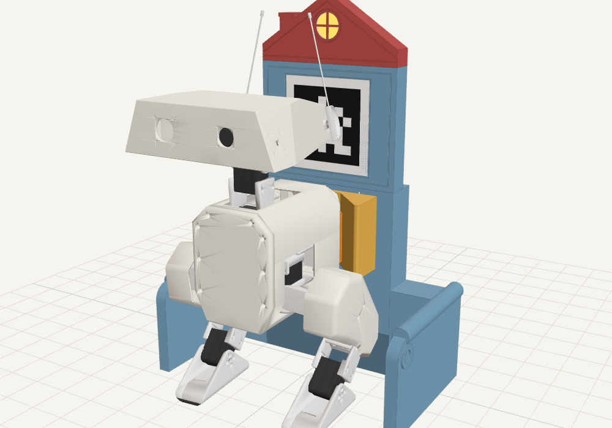
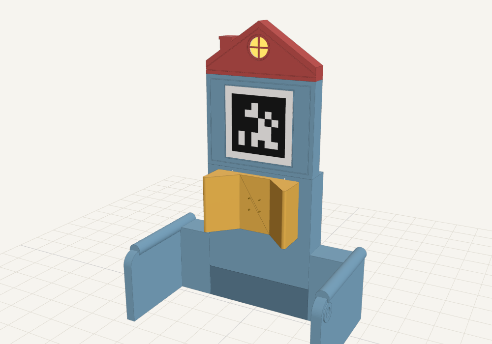
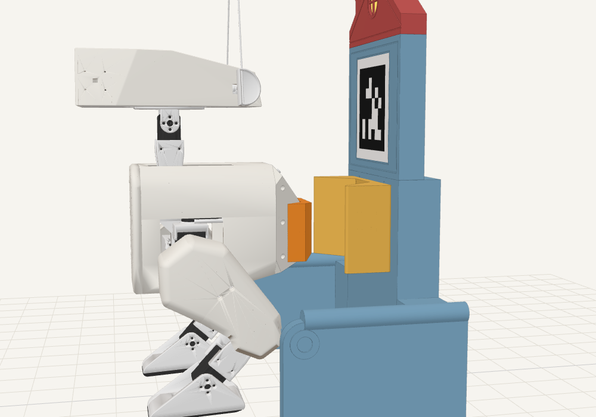
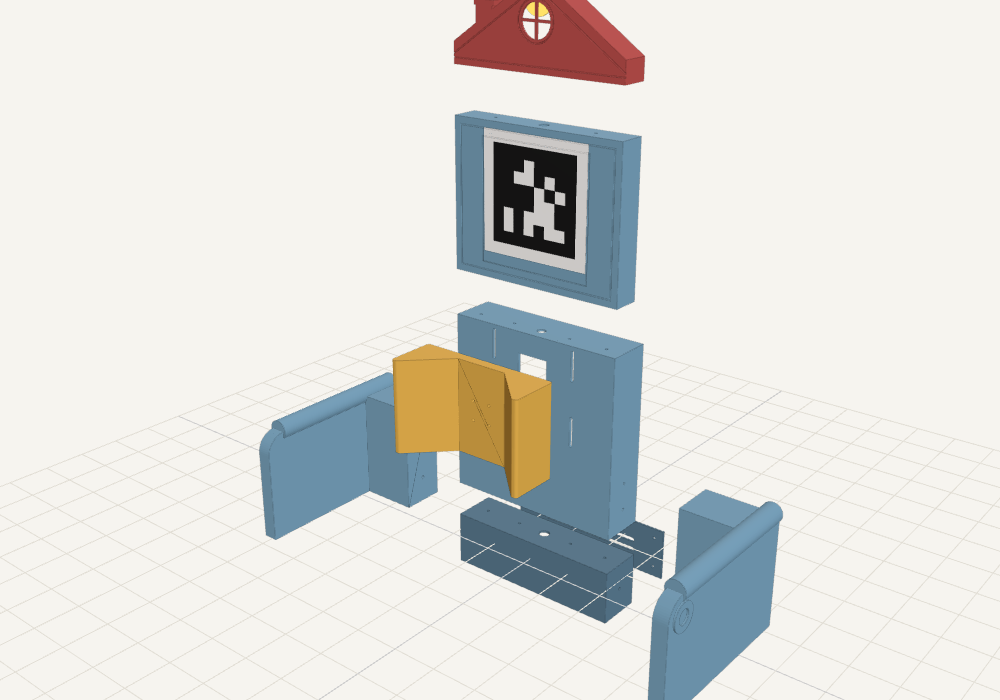
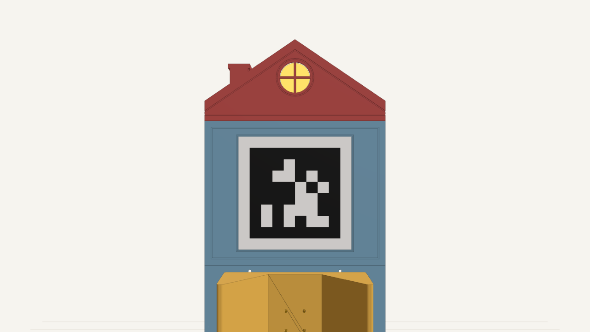
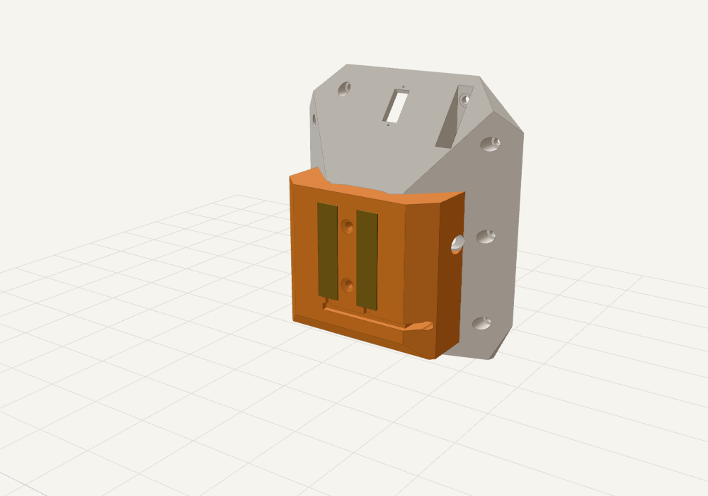
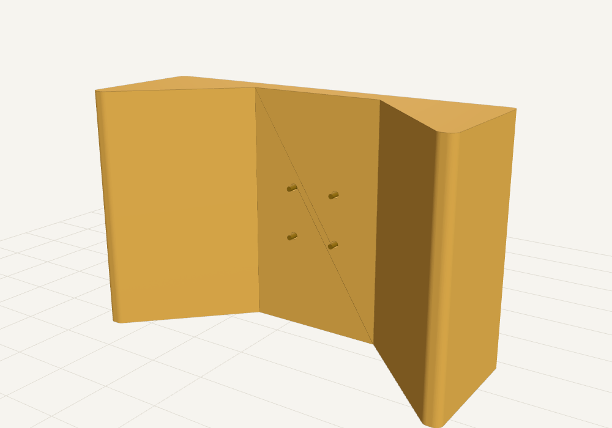

# 充電座：屋形靠背扶手椅（設計 v0）

> **狀態：設計 v0（2026-11-13）**。STL 已由參數化程式產生，通過**幾何層級**的單元測試與無頭瀏覽器渲染檢查。
> **尚未列印、尚未實機驗證**；電路是設計，還沒有做出來。鴨子的站姿來自上游 CAD 的 `home` 姿態，不是實機量測。
> 決策背景見 [ADR-0004](../../docs/adr/ADR-0004-docking-and-charging.md)（觸點在背後、倒退進座），驗證紀錄見 [`docs/validation/dock-cad-2026-11-13.md`](../../docs/validation/dock-cad-2026-11-13.md)。

| 鴨子坐在家裡 | 空的家 |
|---|---|
|  |  |

## 1. 設計概念：倒退回家＝坐進自己的椅子

ADR-0004 已決定觸點在**背後**、鴨子**倒退**進座。倒退坐下這個動作，最自然的「家」就是一張椅子：

| 外觀 | 功能 |
|---|---|
| **屋頂山牆**＋圓窗 | 窗後裝一顆 RGB 燈當狀態燈（空座待機／充電中／充飽／異常）；煙囪只是裝飾 |
| **上椅背**（像沙發靠墊，有一圈縫線溝） | 貼 AprilTag（tag36h11、ID 0、黑框 100 mm），中心離地 340 mm，接近鴨子鏡頭高度（約 370 mm） |
| **V 形導引座**（椅墊的位置） | 接住鴨子背後的觸點凸台；45° 斜面把左右偏差推回中間；4 支彈簧頂針 |
| **中椅背** | 裝 V 形導引座，長槽孔可以上下調 ±15 mm，配合鴨子實際站高 |
| **底座** | 電子艙：USB-C 5 V 輸入、控制板、開關電路 |
| **扶手** | 外觀與防撞；離鴨子至少 41 mm，**不參與導引**（導引只靠 V 形座，避免在髖部高度推鴨子） |

組合後外框：寬 368 mm × 深 200 mm × 高 510 mm。鴨子坐進去後，頭會探出椅子前緣（鏡頭可以繼續看房間，ADR-0003 的固定終端模式）。

| 鴨子倒退進座（側視） | 爆炸圖 |
|---|---|
|  |  |

鴨子在預備點（充電座前方 50 cm）面向充電座時，頭上鏡頭看到的畫面（渲染示意；鏡頭高度 370 mm、AR0144 水平視角 65°、1280×720）：AprilTag 邊長約 196 px，OpenCV 能讀回 ID 0。



## 2. 鴨子要改的地方

### 2.1 背後觸點板（建議：外掛在已印好的原版 `body_back` 上）

使用者已經印好原版 `body_back`（[列印進度](../../docs/build_log/print_status.md)），所以**不用重印**：

| 做法 | 檔案 | 說明 |
|---|---|---|
| **A. 外掛觸點板（建議）** | [`stl/body_back_contact_plate.stl`](stl/body_back_contact_plate.stl) | 內面完全貼合原版背殼的平面背板與兩側 45° 斜角（由上游 STL 布林運算得到）。用膠（環氧樹脂或瞬間膠）加 2 顆 M3 沉頭自攻螺絲固定。約 35 g |
| B. 一體式改裝背殼 | [`stl/body_back_dock.stl`](stl/body_back_dock.stl) | 原版 `body_back` 加上同樣的凸台；只有要重印背殼時才用。沿用上游座標與列印方向 |



觸點板上有：

- **兩條直立的黃銅觸片**（10 × 42 × 0.8 mm），**鴨子左手邊（+y）是正極、右手邊（−y）是負極**。直立長條是為了容許鴨子站高的誤差。
- 觸片下端有缺口通到**走線槽**；導線焊在觸片背面下端，沿走線槽走到 −y 那側，從 **Ø4 線孔**穿進機身（原版 USB-C 充電板在那一側）。線孔要用觸點板上的孔當導孔，在原殼的斜角上鑽穿；走線槽最後用熱熔膠封平。
- 兩側 **45° 導角**：倒退時被充電座的 V 形牆推到正中間。
- 兩顆固定螺絲在兩片觸片**中間**（y = 0），鎖進原殼中央 14.4 mm 厚的實心背板。**先鑽 Ø2.5 導孔、深度不超過 10 mm**（再深會碰到電池座），螺絲用 M3×16 沉頭自攻。螺絲頭要沉到面以下。
- 原殼 −y 斜角上本來就有一個 Ø6 圓孔（從 STL 量得，用途待依上游組裝確認），觸點板在那裡留了 Ø8 通道，**不會擋住**。
- 背殼兩側固定螺絲的沉頭孔（|y| ≈ 41–50 mm）不會被蓋到，起子也伸得進去。

增加的重量約 35 g（板）＋ 7 g（黃銅片）＋導線與電路；更新模擬質量時要算進去（ADR-0005 §2.4）。

### 2.2 鴨子側電路

```text
 觸片＋ ──┬────────────── 理想二極體（或蕭特基）──┬──► 充電板 5 V 輸入
          │                                     │    （與 USB-C VBUS 並聯；USB-C 仍可手動充電）
          ├── 1N4148 ──[10 kΩ 識別電阻]──┐       └──► INA219（選配）── I²C ──► 身體板 Pi Zero 2 W
          ├── TVS（SMAJ5.0A）─────────────┤             （電壓＋電流＝「正在充電」的電氣確認）
 觸片− ──┴───────────────────────────────┴── GND（充電板 GND）
```

- **觸片平常絕不帶電**：二極體擋住電池與 USB-C VBUS，不會反向出現在外露的觸片上（ADR-0004 §2.3 第 1 點）。
- **識別電阻串一顆二極體**：只有極性正確時充電座才量得到它；萬一頂針碰到相反的觸片，充電座看到的是「開路」，不會送電。
- 「已經在充電」**以電氣訊號為準**（INA219 量到電壓與充電電流），不是以「走到了」為準。對應 AIOS 的 `ToolResult`：有電流回讀才是 `confirmed`。
- 待確認：上游 BOM 的 USB-C 充電板**輸入規格**（本設計假設 5 V；ADR-0004 待決第 2 項）。若充電板最低輸入電壓偏高，用理想二極體，不要用壓降 0.4 V 的蕭特基。

### 2.3 回充動作（之後 `robot/` 的程式，規劃中）

幾何驗證給出的參數（數字的算法見驗證紀錄）：

| 項目 | 數值 | 來源 |
|---|---|---|
| 預備點 | 充電座前方約 50 cm，面向充電座看 AprilTag | ADR-0004 §3 |
| 轉身後倒退進座的左右誤差 | **±34 mm 以內**都會先碰到 V 形座、被推回中間；建議目標 ±20 mm | 測試 `test_first_contact_is_boss_on_cradle` |
| 偏航誤差 | ±5° 以內，第一個碰到的仍是 V 形座 | 同上 |
| 頂針開始接觸 | 凸台離椅背 2.5 mm 時 | `PIN_PROTRUDE` |
| 硬停止 | 凸台頂到 V 形座底面（再退 1 mm）；頂針最多壓縮 3.5 mm | `CRADLE_BASE_X` |
| 確認接觸後 | 停止步態、保持站姿；量到充電電流才回報「開始充電」 | ADR-0004 §3 |

倒退時鏡頭看不到充電座，要在面向充電座時算好位姿，轉身 180° 後靠 IMU 航向與視覺里程計倒退（ADR-0004 §2.2）。

## 3. 充電座電路（底座電子艙）

```text
USB-C 5 V／3 A 電源 ─► USB-C 母座板（CC 5.1 kΩ 下拉）─► PTC 保險絲 3 A ─► P-MOSFET 高側開關 ─► 頂針＋（2 支）
                                                          │                     ▲ 控制
                                                          └─[4.7 kΩ 偵測上拉]─► 頂針＋
頂針＋ ─► 分壓 ─► MCU ADC（偵測鴨子）                 MCU（XIAO RP2040 一類）
頂針−（2 支）─► INA219／分流電阻 ─► GND                │
                                                       └─► WS2812 狀態燈（屋頂圓窗）
```

控制邏輯（門檻都**待實測**）：

1. **平常不輸出**（ADR-0004 §2.3 第 2 點），只有 4.7 kΩ 偵測上拉。
2. 量到頂針＋的電壓落在「有識別電阻」的區間（約 3.4–3.8 V），穩定 300 ms → 打開高側開關。開路約 5 V、短路約 0 V、手指或金屬都不會落在這個區間。
3. 供電中監控電流與電壓：超過 2.5 A 或電壓掉下來 → 關閉、等一下再偵測；電流小於約 30 mA 持續 10 秒（充飽或鴨子離開）→ 關閉、回到偵測。
4. 狀態燈：暖白微亮＝空座待機、琥珀呼吸＝充電中、綠＝充飽、紅閃＝異常。

## 4. 列印清單

全部 ≤ 200 × 200 × 200 mm，放得進 Prusa MK4、Ender-3 系列、Bambu Lab P1／X1／A1。全部**免支撐**。PLA 或 PETG，層高 0.2 mm，3 圈牆，填充 15%（V 形座建議 30%）。重量是**估算**（`stl/parts.json` 有算法），以切片軟體為準。

| 檔案 | 用途 | 必要性 | 列印尺寸 (mm) | 列印方向 | 估重 |
|---|---|---|---|---|---|
| [`body_back_contact_plate.stl`](stl/body_back_contact_plate.stl) | 鴨子背後觸點板 | **必印** | 68 × 76 × 31 | 觸點面朝下 | 35 g |
| [`dock_cradle.stl`](stl/dock_cradle.stl) | V 形導引座 | **必印** | 100 × 156 × 54 | 貼椅背那面朝下 | 144 g |
| [`dock_plinth.stl`](stl/dock_plinth.stl) | 底座／電子艙 | **必印** | 60 × 200 × 50 | 正面朝下 | 119 g |
| [`dock_backrest_mid.stl`](stl/dock_backrest_mid.stl) | 中椅背（裝 V 形座） | **必印** | 200 × 200 × 50 | 正面朝下 | 229 g |
| [`dock_rear_cover.stl`](stl/dock_rear_cover.stl) | 電子艙後蓋 | **必印** | 59 × 199 × 2 | 平放 | 26 g |
| [`dock_backrest_upper.stl`](stl/dock_backrest_upper.stl) | 上椅背（AprilTag） | 建議 | 160 × 200 × 30 | 正面朝下 | 161 g |
| [`dock_roof.stl`](stl/dock_roof.stl) | 屋頂（狀態燈窗、煙囪） | 建議 | 90 × 200 × 30 | 正面朝下 | 81 g |
| [`dock_arm_left.stl`](stl/dock_arm_left.stl)、[`dock_arm_right.stl`](stl/dock_arm_right.stl) | 扶手（中空、底部開口） | 選印（外觀） | 198 × 84 × 136 | 底面朝下直立 | 各 249 g |
| [`body_back_dock.stl`](stl/body_back_dock.stl) | 一體式改裝背殼 | 只有重印背殼時 | 48 × 110 × 125 | 同上游 | 99 g |
| [`dock_apriltag_tag36h11_id0.svg`](stl/dock_apriltag_tag36h11_id0.svg) | AprilTag 紙本 | **必印**（紙） | 145 × 153（含裁切留白與說明文字） | 以 100% 列印、不要縮放 | — |

- 只印「必印」：充電座約 520 g；加上建議件約 760 g；全部約 1.26 kg。
- 屋頂圓窗可以用白色或半透明 PETG 印一片小圓片當燈罩，或在窗後貼一張描圖紙。
- AprilTag：印完用尺量**黑框邊長要是 100 mm**；建議貼霧面膠帶或護貝（避免反光），貼在上椅背的對位框內。

## 5. 五金與電子零件

| 項目 | 數量 | 規格 | 用在 |
|---|---|---|---|
| M3 熱熔螺帽 | 24 | 孔 Ø4.0、長 ≤ 6 mm | V 形座 4、中椅背底 4、上椅背底 4、屋頂 2、底座後蓋柱 4、扶手側翼 6 |
| M3×8 螺絲 | 20 | ＋4 片墊片（V 形座長槽孔用） | V 形座 4、底座→中椅背 4、中→上椅背 4、上椅背→屋頂 2、扶手 6 |
| M3×6 螺絲 | 4 | | 後蓋 |
| M3×16 沉頭自攻 | 2 | | 鴨子觸點板 |
| 彈簧頂針（pogo pin） | 4 | 外徑約 Ø3（孔徑參數 `PIN_BORE` 預設 3.1 mm，依實際零件改）、**行程 ≥ 4 mm**、額定 ≥ 2 A | V 形座 |
| 黃銅片 | 2 | 10 × 0.8 mm，裁 42 mm 長 | 鴨子觸點板 |
| 矽膠線 22 AWG、熱縮管 | 適量 | 紅＝正、黑＝負 | 兩邊 |
| 橡膠止滑墊 | 6 | | 底座與扶手底部（防止鴨子倒退時把家推走） |
| USB-C 電源 | 1 | 5 V 3 A | 充電座 |
| USB-C 母座板 | 1 | 有 CC 5.1 kΩ 下拉 | 充電座 |
| MCU 板 | 1 | 有 ADC，例如 Seeed XIAO RP2040 | 充電座 |
| P-MOSFET、NPN、PTC 3 A、電阻 | 1 套 | 例如 AO3401A | 充電座 |
| INA219 模組 | 1（充電座）＋1（鴨子，選配） | | 電流與電壓 |
| WS2812 單顆 LED | 1 | | 屋頂狀態燈 |
| 理想二極體模組（或 SS54 蕭特基）、1N4148、10 kΩ、SMAJ5.0A | 1 套 | | 鴨子側 |

型號是建議，**都還沒有實際採購或驗證**。

## 6. 組裝



1. 所有熱熔螺帽燙進去。
2. **頂針**：從 V 形座背面插入，讓尖端**凸出 V 形座底面 3.5 mm**，用環氧樹脂固定（膠不能流進頂針的彈簧）。**面對椅子看，右邊兩支是正極**（＝鴨子坐進來時的左手邊），左邊兩支是負極。導線從中椅背的頂針窗穿進去。
3. V 形座從中椅背**後面**用 4 顆 M3×8＋墊片鎖住，先鎖在長槽孔的正中間。
4. 底座 → 中椅背（從電子艙裡往上鎖 4 顆）→ 上椅背（從中椅背後面往上鎖 4 顆）→ 屋頂（2 顆）。
5. 電子艙：控制板放底座，USB 線從後蓋下緣的缺口進來；頂針的線從中椅背底部的孔下來；狀態燈的線從中央的走線孔一路往上到屋頂圓窗。鎖上後蓋。
6. 扶手：從椅背內側各鎖 3 顆。
7. 貼 AprilTag。
8. 鴨子這邊：鑽線孔、焊觸片、裝觸點板、接 2.2 節的電路。
9. **高度校正**：讓鴨子以步態的站姿倒退坐進去，在頂針尖端塗一點白板筆，看觸片上的印子是否在上下的中間；不在中間就鬆開 V 形座的 4 顆螺絲上下調整（±15 mm）。

## 7. 驗證狀態

驗證層級：**單元測試（幾何）＋無頭瀏覽器渲染**。完整數字與指令見 [驗證紀錄](../../docs/validation/dock-cad-2026-11-13.md)。

| 檢查 | 結果 |
|---|---|
| 10 個 STL 都是封閉實體、≤ 200 mm、與程式產生的一致 | 通過 |
| 鴨子（home 站姿）停好時與充電座零干涉 | 通過；凸台離 V 形牆 1.0 mm，鴨子其他部位離 V 形座 ≥ 16 mm、離扶手 ≥ 41 mm |
| 頂針落在觸片上 | 左右餘裕 4 mm（坐好後只剩 2 mm 晃動）；上下：兩支都接觸 ±9.5 mm、至少一支接觸 ±30.5 mm；前傾後仰 ±3° 仍接觸 |
| 倒退進座的捕捉範圍 | 左右偏 ±34 mm、偏航 ±5°：第一個碰到的都是凸台與 V 形座 |
| 外掛觸點板 | 單一實體、與原殼零重疊、貼合面積約 64 cm²；凸台不伸進電池艙、不擋原有圓孔 |
| AprilTag | OpenCV 讀回 ID 0；渲染的鴨子鏡頭畫面（50 cm）也讀得到 |

**還沒驗證**：實際列印尺寸與公差、頂針與黃銅片的接觸電阻、鴨子實機站高與晃動、倒退步態能不能穩定走進 V 形座、充電座被推動的距離、電路門檻、充電板輸入規格。

## 8. 已知限制與待辦

1. 鴨子站姿用上游 `home` 姿態，沒有實機量測；V 形座的 ±15 mm 調整與單支頂針 ±30 mm 的容許範圍就是為了吸收這個差異。
2. 原版背殼 −y 斜角上 Ø6 圓孔的用途還沒確認（已保留通道）。
3. 鴨子倒退頂到 V 形座時會推動充電座：底部要貼止滑墊，建議靠牆擺放；推力與滑動量要實測。
4. 頂針規格依買到的零件調整 `PIN_BORE`、`PIN_PROTRUDE`，然後重新產生 STL。
5. 電路是設計，還沒做出來；偵測電壓區間、電流門檻要實測。
6. 尚未加入組裝檢視器（`assembly_viewer/`），也還沒把新增的質量放進 `sim/` 的模型。

## 9. 修改參數、重新產生

所有尺寸都在 [`cad/dock_cad/params.py`](cad/dock_cad/params.py)，鴨子的位置由上游 MJCF 計算（[`cad/dock_cad/duck.py`](cad/dock_cad/duck.py)），不手抄。

```bash
cd nous_duck/hardware/dock/cad
```

```bash
pip install -r requirements-dev.txt
```

```bash
python -m dock_cad
```

```bash
python -m pytest tests -v
```

示意圖（開發工具，需要 Playwright 與 three@0.170.0 的 `three.module.js`，CI 不跑）：

```bash
python -m dock_cad.render --three /path/to/three.module.js
```

| 檔案 | 內容 |
|---|---|
| `cad/dock_cad/params.py` | 全部尺寸與座標系說明 |
| `cad/dock_cad/duck.py` | 從上游 `robot.xml` 算鴨子 home 站姿，換到充電座座標 |
| `cad/dock_cad/body_back_mod.py` | 觸點凸台、外掛觸點板、一體式背殼 |
| `cad/dock_cad/dock_parts.py` | 充電座各零件 |
| `cad/dock_cad/fit.py` | 干涉、對位、捕捉範圍計算 |
| `cad/dock_cad/tag.py` | AprilTag SVG |
| `cad/dock_cad/build.py` | 輸出 STL、SVG、`parts.json` |
| `cad/dock_cad/render.py` | 示意圖 |

上游檔案（`print/body_back.stl`、`mini_bdx/robots/open_duck_mini_v2/`）只讀不改；產生的檔案都在本目錄。
