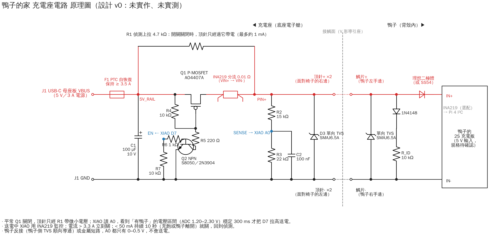
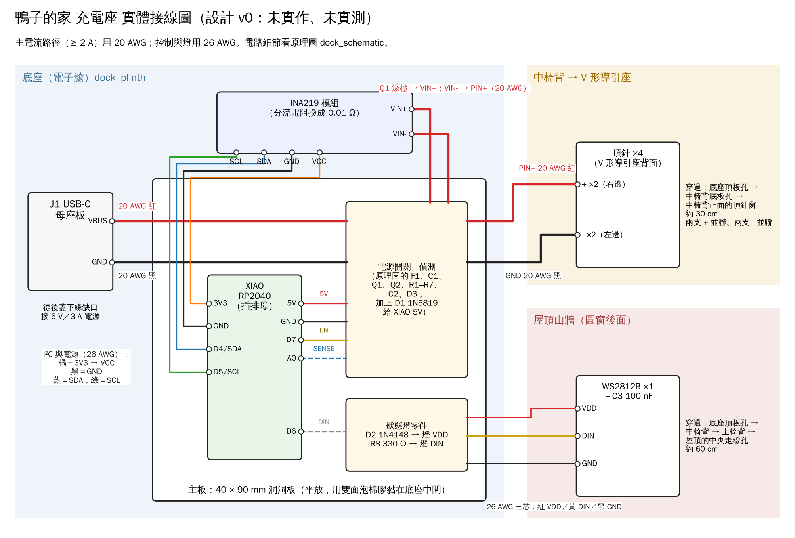

# 充電座電路接線圖（設計 v0）

> **狀態：設計 v0（2026-11-26）。還沒有做出來、沒有量測過。**
>
> - **已驗證**：元件值與門檻用程式算過，在最壞的元件誤差下仍分得開。計算在 [`../cad/dock_cad/electrical.py`](../cad/dock_cad/electrical.py)，測試在 [`../cad/tests/test_electrical.py`](../cad/tests/test_electrical.py)（CI 會跑）。
> - **未驗證**：實際電壓、壓降、發熱，以及鴨子充電板的輸入規格。
> - **韌體**：還沒寫，這裡只寫它應該怎麼動作。

上層文件：[`../README.md`](../README.md)。

## 原理圖

充電座側在左、鴨子側在右，中間的虛線是 V 形導引座的接觸面。



## 實體接線圖

圖上標出模組、線色、線徑，以及每條線要穿過椅背的哪個孔。



另有 SVG 版：[`dock_schematic.svg`](dock_schematic.svg)、[`dock_wiring.svg`](dock_wiring.svg)。

## 怎麼運作

1. **平常不送電**：Q1 關著，頂針＋只經過 R1（4.7 kΩ）帶一點電壓。就算有人用金屬把兩極短路，電流也只有約 1 mA。
2. **偵測鴨子**：XIAO 從 A0 讀頂針＋經 R2、R3 分壓後的電壓。鴨子坐好時，鴨子側的「1N4148＋10 kΩ 識別電阻」會把電壓拉到一個固定區間。這個值在區間內穩定 300 ms，XIAO 才把 D7 拉高，經 Q2 打開 Q1 送電。
3. **送電中監控**：XIAO 透過 I²C 讀 INA219 的電流與電壓。
   - 電流超過 3.3 A：立刻關。
   - 電流小於 50 mA 持續 10 秒（充飽或鴨子走了）：關掉，回到偵測。
   - 送電 5 秒後電流仍小於 20 mA（接上的不是在充電的東西）：關掉。
4. **不會誤送電的情況**：
   - 鴨子反接：鴨子側的單向 TVS 會順向導通，把電壓鉗在約 0.7 V。
   - 金屬短路：0 V。
   - 沒有鴨子：約 4.4 V。
   
   三種讀值都在送電區間外，所以不送電。
5. **狀態燈**（屋頂圓窗）：暖白微亮＝空座待機、琥珀呼吸＝充電中、綠＝充飽、紅閃＝異常。

## 偵測門檻（設計計算）

最壞組合的條件：
- 電源 4.75–5.25 V
- 1% 電阻
- 1N4148 壓降 0.5–0.7 V
- 鴨子充電板在偵測時可能吃掉 0–200 µA

| 情況 | 頂針＋電壓 | A0 讀值（分壓後） | 結果 |
|---|---|---|---|
| 沒有鴨子 | 4.21–4.67 V | 2.48–2.80 V | 不送電 |
| **鴨子坐好** | 2.51–3.52 V | **1.48–2.11 V** | **送電** |
| 鴨子反接 | 0.60–0.85 V | 0.35–0.51 V | 不送電 |
| 金屬短路 | 0 V | 0 V | 不送電 |

韌體的送電區間設成 **A0 = 1.20–2.30 V**。它和每一種情況之間都至少留了 0.18 V 的距離。

送電中，A0 最高約 3.15 V，不會超過 XIAO 的 3.3 V 上限。

## 零件表

型號是建議，**都還沒實際採購或驗證**。買到後請對照規格書，特別是 Q1 的 Vgs(th) 與 Rds(on)。

| 編號 | 零件 | 規格 | 數量 | 說明 |
|---|---|---|---|---|
| J1 | USB-C 母座板 | 有 CC 5.1 kΩ 下拉（才能從 USB-C 充電器拿到 5 V） | 1 | 裝在後蓋下緣缺口內側 |
| — | USB-C 電源 | 5 V／3 A；輸出 5.1–5.2 V 的較好 | 1 | |
| F1 | PTC 自恢復保險絲 | 保持電流 ≥ 3.5 A、內阻 ≤ 30 mΩ | 1 | 型號依規格書挑 |
| C1 | 電解電容 | 100 µF／10 V 以上 | 1 | |
| Q1 | P-MOSFET | **AO4407A**（SO-8，−30 V，Vgs −4.5 V 時約 20 mΩ） | 1 | 焊在 SO-8 轉 DIP 小板上比較好焊 |
| Q2 | NPN 電晶體 | S8050 或 2N3904 | 1 | |
| R1 | 電阻 | 4.7 kΩ 1% | 1 | 偵測上拉 |
| R2、R3 | 電阻 | 15 kΩ、22 kΩ 1% | 各 1 | 分壓到 A0 |
| R4 | 電阻 | 10 kΩ | 1 | 閘極上拉（平常關） |
| R5 | 電阻 | 220 Ω | 1 | |
| R6、R7 | 電阻 | 1 kΩ、10 kΩ | 各 1 | 基極電阻、下拉 |
| R8 | 電阻 | 330 Ω | 1 | 燈的資料線 |
| C2 | 陶瓷電容 | 100 nF | 1 | A0 濾波 |
| C3 | 陶瓷電容 | 100 nF | 1 | 焊在 WS2812B 旁邊 |
| D1 | 蕭特基二極體 | 1N5819 | 1 | 5V_RAIL → XIAO 5V；用 USB 燒錄時擋住倒灌 |
| D2 | 二極體 | 1N4148 | 1 | 燈的 VDD 降到約 4.3 V，讓 3.3 V 資料線夠高 |
| D3 | **單向** TVS | SMAJ6.5A（**不是 CA 雙向版**） | 1 | 頂針＋對地防靜電 |
| U1 | 微控制器 | Seeed **XIAO RP2040** | 1 | 插在洞洞板的排母上 |
| U2 | 電流電壓模組 | **INA219** 模組 | 1 | 建議把分流電阻 R100 換成 R010（0.01 Ω，2512 封裝） |
| LED | RGB 燈 | WS2812B 單顆（或小板） | 1 | 屋頂圓窗後面 |
| — | 洞洞板 | 40 × 90 mm | 1 | 平放在底座中間 |
| — | 線材 | 20 AWG（紅、黑）約 1 m；26 AWG 三芯約 0.7 m；杜邦線若干 | — | |

### 為什麼 TVS 用 6.5 V 而不是 5.0 V

5 V 的 TVS 在 5 V 時漏電可能到幾百 µA。這會把偵測用的微小電壓拉歪，鴨子側的 TVS 也一樣。所以兩邊都用 SMAJ6.5A，而且必須是**單向**版：鴨子反接時要靠它順向導通，把電壓鉗低。

## XIAO RP2040 腳位

| XIAO 腳位 | 接到 | 用途 |
|---|---|---|
| 5V | D1 陰極（← 5V_RAIL） | 供電 |
| GND | 共地 | |
| 3V3 | INA219 VCC | INA219 的 I²C 上拉要接 3.3 V，不能接 5 V |
| D0／A0 | R2、R3 中點（SENSE） | 偵測鴨子、送電中量電壓 |
| D4／SDA | INA219 SDA | I²C（位址預設 0x40） |
| D5／SCL | INA219 SCL | I²C |
| D6 | R8 → WS2812B DIN | 狀態燈 |
| D7 | R6 → Q2 基極（EN） | 高電位＝送電 |

## 壓降（設計估算，要實測）

電流越大，壓降越大，鴨子充電板收到的電壓就越低：

| 電流 | 充電座到鴨子觸片的壓降 | 鴨子觸片上的電壓（電源 5.0 V 時） |
|---|---|---|
| 2 A | 約 0.29 V | 約 4.7 V |
| 3 A | 約 0.44 V | 約 4.56 V |

各段的估計值寫在 `electrical.py` 的 `DROP_BUDGET_OHM`：USB-C 座、PTC、Q1、分流電阻、20 AWG 線、頂針與黃銅片。鴨子側的理想二極體還會再掉約 0.05 V；改用 SS54 蕭特基會掉約 0.4 V，不建議。

鴨子的充電板如果在輸入電壓偏低時會自動降低電流，結果只是充得比較慢。實際情況要看到時候的量測。

## 焊好後先這樣測（不接鴨子）

每一步的數字都對了，才進下一步。

1. **還沒插 XIAO**：接上 USB-C 電源。
   - 5V_RAIL 應為 5 V 左右。
   - 頂針＋對地約 4.4 V（只經 R1，沒有送電）。
2. **假鴨子**：把 1N4148 和 10 kΩ 串聯（二極體陰極朝 10 kΩ），接在頂針＋（陽極端）與頂針−之間。
   - 頂針＋應掉到約 3.3 V。
3. **反接假鴨子**：把二極體方向反過來。這時二極體不導通，頂針＋回到約 4.4 V，一樣不在送電區間。
4. **短路**：用電錶的電流檔量兩極短路電流，應約 1 mA。
5. **插上 XIAO、燒韌體**（韌體之後寫），再用假鴨子確認：
   - 接上會送電，頂針＋變成約 5 V。
   - 拿掉假鴨子後，10 秒內關閉。
6. **負載測試**：在假鴨子旁並聯一顆 5 Ω／10 W 電阻（約 1 A），量：
   - INA219 的讀值
   - 頂針上的電壓
   - Q1 與 PTC 會不會燙
7. 最後才接鴨子。第一次一定要在旁邊看著，手放在 USB 線上，有異狀就拔。

## 鴨子側

鴨子背殼裡的電路也畫在原理圖右半邊：

- 觸片＋ → 單向 TVS 到地
- 1N4148＋10 kΩ 識別電阻到地
- 理想二極體 → 鴨子 2S 充電板的 5 V 輸入（與原本的 USB-C 輸入並聯）

如果要讓鴨子自己確認「正在充電」，在理想二極體後面加一顆 INA219。現在是單板 Pi 4 試用期（[ADR-0008](../../../docs/adr/ADR-0008-single-board-pi4.md)），所以接到 Pi 4 的 I²C。

## 待確認

1. 鴨子 2S 充電板的輸入規格：電壓範圍、最大輸入電流（[ADR-0004](../../../docs/adr/ADR-0004-docking-and-charging.md) 待決第 2 項）。電流超過 3 A 的話，F1、Q1、線材都要重選。
2. 所有門檻都要用實際電路量過再調。
3. 3.3 V 資料線驅動降壓後的 WS2812B，計算上只剩約 0.08 V 的餘裕。不穩的話改用 74AHCT125 轉準位，或改用 SK6812。

## 重新產生圖

開發工具，CI 不跑：

```bash
pip install schemdraw==0.23 matplotlib
```

```bash
python nous_duck/hardware/dock/wiring/draw_wiring.py
```

元件值改在 [`../cad/dock_cad/electrical.py`](../cad/dock_cad/electrical.py)，改完重新畫圖，並執行 `python -m pytest nous_duck/hardware/dock/cad/tests/test_electrical.py`。
